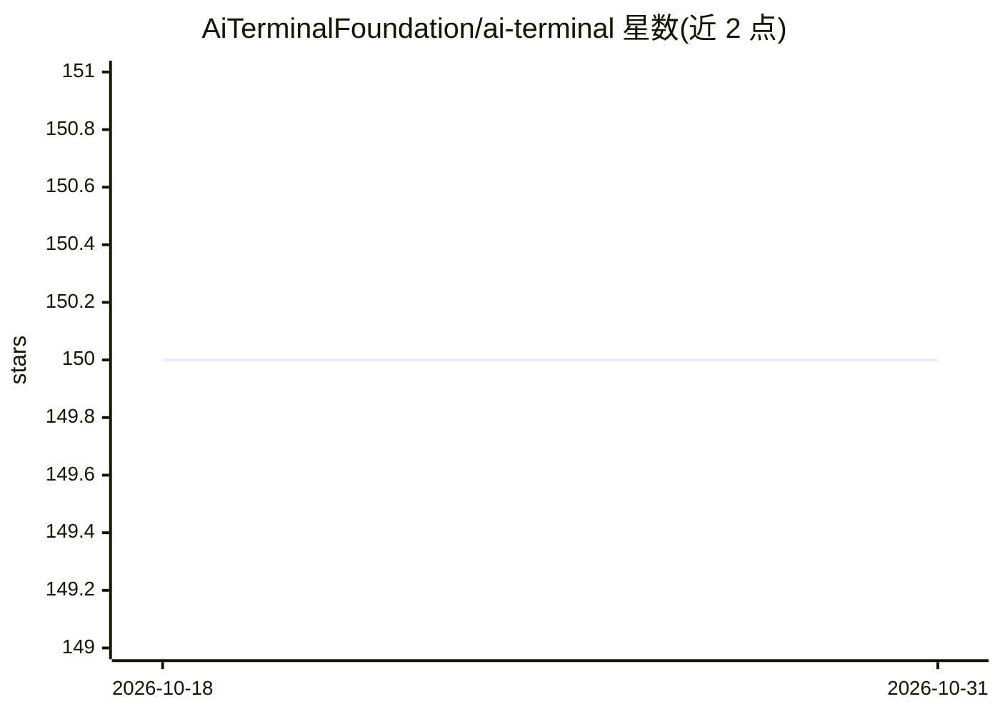

# AiTerminalFoundation/ai-terminal

⭐ 150 · Rust · 推送 2026-05-09 · [GitHub](https://github.com/AiTerminalFoundation/ai-terminal) · [官网](https://ai-terminal.dev/) · 组织维护

**集成 AI 助手的跨平台终端应用（Tauri+Angular）**

基于 Tauri 与 Angular 构建的桌面终端应用，内置 AI 能力：自然语言命令解释、AI 助手、命令历史与自动补全，支持 macOS、Windows、Linux。AI 功能依赖本地 Ollama 运行时，README 给出安装 Ollama 并拉取 macsdeve/BetterBash3 模型的指引。macOS 提供 Homebrew cask 安装，开发需 Node.js 18+ 与 Rust/Cargo，从源码运行。

## 筛选速览

| 维度 | 判定 | 备注 |
|---|---|---|
| AI 角色 | `ai-enhanced` | 去掉 AI 部分产品仍成立 |
| 许可风险 | `none` | — |
| 部署形态 | `desktop` | 安装包/桌面程序 |
| 模型依赖 | local-ok | 支持本地模型 |
| 硬件要求 | — | 无带数字的原话,不猜 |
| 安装摩擦 | `low` | 无编译、无系统依赖或容器化 |
| 成熟度 | — | 结构信号不足 |

## 能力要点

- 自然语言命令解释与内置 AI 助手
- 命令历史与自动补全
- 跨平台支持（macOS/Windows/Linux）
- AI 功能通过本地 Ollama 运行模型

## 适用场景

- 在终端里用自然语言生成命令
- 用本地模型获得 AI 助手辅助的命令行操作
- macOS 用户通过 Homebrew 一键安装

## 场景标签

`AI 助手` `代码生成` · 领域:编码与开发

## 证据(README 行号)

> L3: A Tauri + Angular terminal application with integrated AI capabilities.
> L7: - Natural language command interpretation
> L17: - For AI features: Ollama (can be installed with `brew install ollama`)

## 星数曲线

2026-10-18 150 → 2026-10-31 150（+0）

---
*卡片 v1 · prompt 1.4 · 生成 2026-10-22 · 置信度 mid · 依据 README sha `753d0947f14d` · [字段定义](../../DATASET.md)*
