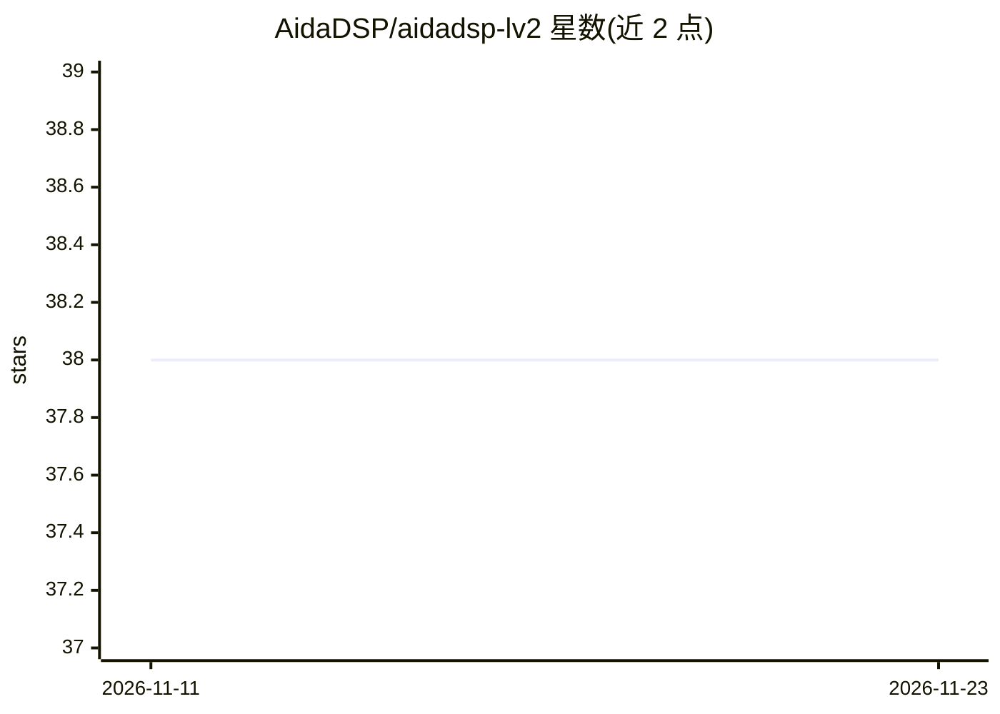

# AidaDSP/aidadsp-lv2

⭐ 38 · C++ · GPL-3.0 · 推送 2026-11-11 · [GitHub](https://github.com/AidaDSP/aidadsp-lv2) · 个人维护

**LV2 音频插件包：用神经网络建模吉他放大器与踏板**

Aida DSP 维护的 LV2 格式音频插件包（1.0 版），面向 MOD Audio 产品及其衍生硬件使用。核心插件 rt-neural-generic.lv2 基于 RTNeural 运行神经网络模型来模拟吉他放大器或踏板，带五段 EQ、输入输出音量控制，支持通过 atom 消息加载 json 模型文件；模型需用附带的 AIDA-X Model Trainer.ipynb 训练生成。已集成进 MOD Audio 的 MPB 构建系统，也可用 aidadsp SDK 交叉编译（支持 aarch64，可选拟 xsimd/Eigen 后端）。

## 筛选速览

| 维度 | 判定 | 备注 |
|---|---|---|
| AI 角色 | `ai-native` | 本体是模型或模型工具 |
| 许可风险 | `viral` | GPL-3.0 |
| 部署形态 | `None` |  |
| 模型依赖 | — | README 未给出锁定关系 |
| 硬件要求 | — | 无带数字的原话,不猜 |
| 安装摩擦 | `medium` | 含编译或系统依赖之一 |
| 成熟度 | — | 结构信号不足 |

## 能力要点

- 基于 RTNeural 运行神经网络建模放大器/踏板
- 五段 EQ（可调 Q 值、频率、前/后切换）与音量控制
- 通过 atom 消息加载 json 神经网络模型文件
- 集成 MOD Audio MPB 构建系统，支持 aarch64 交叉编译

## 适用场景

- 在 MOD Audio 设备上演奏神经网络建模的放大器/踏板音色
- 把自训练的 AIDA-X json 模型加载进插件使用
- 为 aarch64 嵌入式音频平台编译部署该插件包

## 场景标签

`推理引擎` `模型训练` · 领域:训练与推理

## 证据(README 行号)

> L17: It's a lv2 plugin that leverages RTNeural to model
> L20: - Play realistic Amps or Pedals captured with cutting-edge ML technology

## 星数曲线

2026-11-11 38 → 2026-11-23 38（+0）

---
*卡片 v1 · prompt 1.4 · 生成 2026-11-18 · 置信度 high · 依据 README sha `1f1a86cb9c4f` · [字段定义](../../DATASET.md)*
