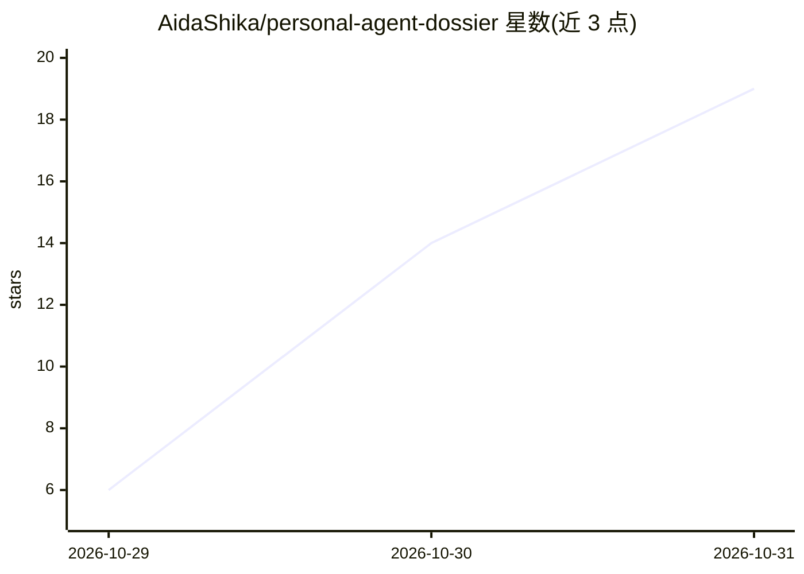

# AidaShika/personal-agent-dossier

⭐ 19 · Python · MIT · 推送 2026-10-29 · [GitHub](https://github.com/AidaShika/personal-agent-dossier) · 个人维护 · 中文 README

**个人 AI agent 跨平台迁移的中立档案格式与适配器**

定义一种可携带的 dossier 文件格式（YAML front matter + Markdown 正文），把个人 agent 的角色、反任务、定时例程、长期记忆、依赖与技能打包为单个文件，用 12 位十六进制 SHA-1 指纹在两平台间检测漂移。导入先以 dry-run 展示计划与丢失清单，导入方需声明能力等级（L0/L1/L2）。提供 Grok Bot、Muse、Hermes、OpenClaw 适配器及自查脚本，导出/导入双侧扫描敏感信息并拒绝命中文件。面向需要在不同 agent 平台间搬迁的用户与平台适配器开发者。

## 筛选速览

| 维度 | 判定 | 备注 |
|---|---|---|
| AI 角色 | `ai-ecosystem` | LLM/agent 周边工具 |
| 许可风险 | `permissive` | MIT |
| 部署形态 | `library` | 以包/库形式分发 |
| 模型依赖 | — | README 未给出锁定关系 |
| 硬件要求 | — | 无带数字的原话,不猜 |
| 安装摩擦 | `low` | 无编译、无系统依赖或容器化 |
| 成熟度 | — | 结构信号不足 |

## 能力要点

- 单个 .dossier.md 文件携带角色、例程、记忆、依赖与指纹
- 导入先 dry-run，输出逐项丢失/降级清单，不静默丢弃字段
- L0/L1/L2 能力等级声明与 12 位 SHA-1 指纹漂移检测
- 四个平台适配器（Grok Bot/Muse/Hermes/OpenClaw）及一致性测试

## 适用场景

- 把长期使用的个人 agent 从一个平台搬到另一个平台
- 核验他人交付的 dossier 文件字段与指纹是否一致
- 为自己的 agent 平台编写适配器加入迁移生态

## 场景标签

 · 领域:AI agent 基础设施/数据可移植性

## 证据(README 行号)

> L46: **personal-agent-dossier** packages that hand-over into one portable file: YAML front matter a machine can verify, 
> L87: Writing an adapter for your platform is the intended way to join: follow the guide in `skills/personal-agent-dossie

## 星数曲线

2026-10-29 6 → 2026-10-31 19（+13）

---
*卡片 v1 · prompt 1.4 · 生成 2026-10-30 · 置信度 mid · 依据 README sha `6e12242830ca` · [字段定义](../../DATASET.md)*
