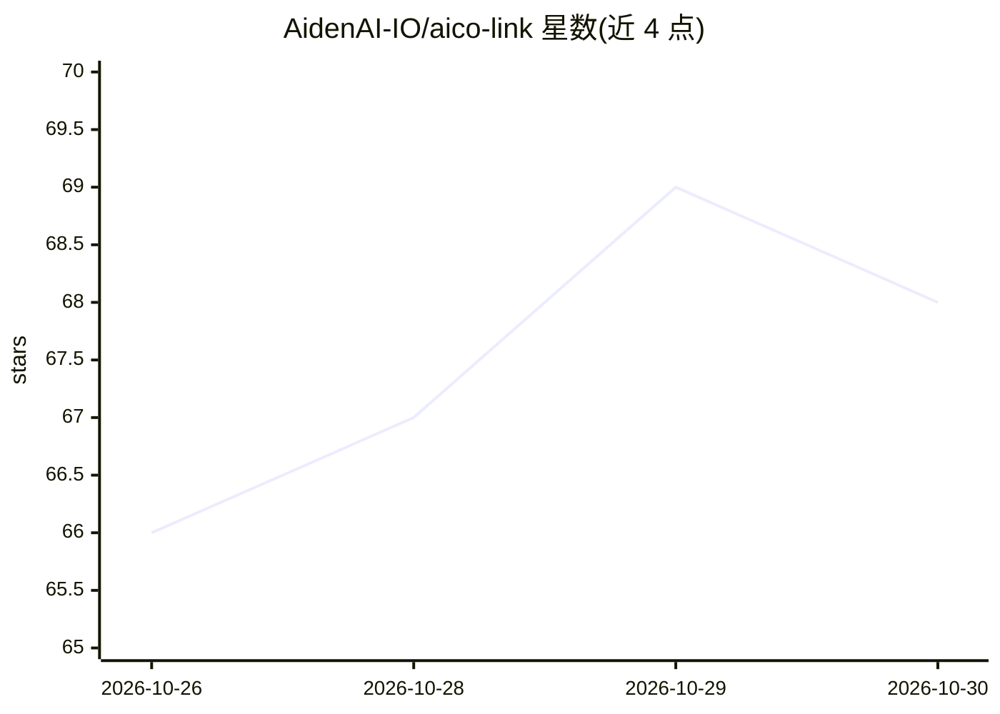

# AidenAI-IO/aico-link

⭐ 68 · C · NOASSERTION · 推送 2026-10-29 · [GitHub](https://github.com/AidenAI-IO/aico-link) · [官网](https://aico.link/) · 组织维护

**让 AI Agent 通过 HDMI 采集与 USB HID 操控手机/电脑的开发板固件**

Aico Link 是一块自组装开发板（Luckfox Pico Zero + RK628D HDMI-CSI 桥 + ASRPRO 语音），本仓库提供其 Debian 固件 overlay、C++ 硬件服务（HDMI 截屏、音频）、Go Agent 运行时与 OTA 工具。Go Agent 将截图发送到用户配置的多模态模型，决策下一步动作并写入 USB HID 设备节点，从而操控不开放自动化 API 的手机或桌面应用；另含硬件 VAD 语音链路（STT/LLM/TTS 均为用户自配端点）。明确声明这是开发板实现而非最终集成硬件产品，也提供 docker compose 的无硬件 PC 沙盒体验。

## 筛选速览

| 维度 | 判定 | 备注 |
|---|---|---|
| AI 角色 | `ai-native` | 本体是模型或模型工具 |
| 许可风险 | `dual` | NOASSERTION |
| 部署形态 | `self-host` | docker 或自建部署 |
| 模型依赖 | local-ok | 支持本地模型 |
| 硬件要求 | — | 无带数字的原话,不猜 |
| 安装摩擦 | `low` | 无编译、无系统依赖或容器化 |
| 成熟度 | `idea` | |

## 能力要点

- HDMI 采集观察 + USB HID 控制，无需越狱/ADB/开发者模式
- Go Agent：截图发送多模态模型决策后写入 /dev/hidg* 设备节点
- 硬件 VAD 唤醒与流式 STT/TTS 语音交互
- A/B 分区 OTA、签名清单与 abctl 诊断

## 适用场景

- 自组装一块让 AI Agent 操控普通手机 App 的硬件
- 在 PC 上用 docker 沙盒无硬件体验 Aico Agent
- 为无自动化 API 的目标设备做 Agent 控制与基准测试

## 场景标签

`GUI 自动化` · 领域:效率与自动化

## 证据(README 行号)

> L5: **Aico Link** is the hardware. **Aico** is the AI Agent that runs on it.
> L37: - the Go Agent sends screenshots to a configured multimodal model, decides the next action, and writes keyboard, po
> L79: - **Go Agent**: the device-side LLM runtime, voice loop, skills, memory, and built-in screenshot/HID/audio/shell to

## 星数曲线

2026-10-26 66 → 2026-10-30 68（+2）

---
*卡片 v1 · prompt 1.4 · 生成 2026-10-27 · 置信度 high · 依据 README sha `05b3830e0f5b` · [字段定义](../../DATASET.md)*
