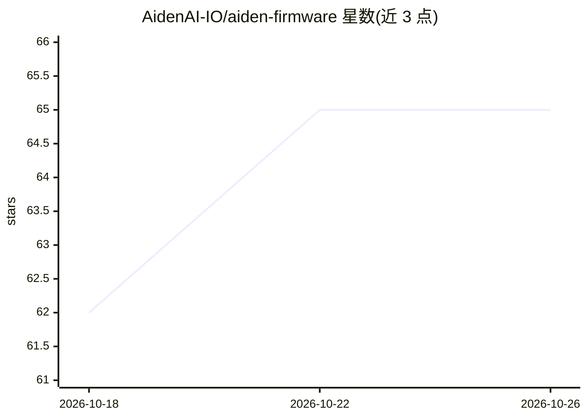

# AidenAI-IO/aiden-firmware

⭐ 65 · Go · NOASSERTION · 推送 2026-10-24 · [GitHub](https://github.com/AidenAI-IO/aiden-firmware) · [官网](https://aidenai.io) · 组织维护

**移动设备 AI Agent 开发板固件：HDMI 观测 + USB HID 控制手机**

面向 Aiden 开发板的固件与设备端 Agent 运行时：通过 HDMI 采集目标设备画面、以 USB HID 键鼠/触控信号控制普通手机或桌面应用，不依赖越狱、ADB 或应用专属自动化 API。Go Agent 将截图发送至用户配置的多模态模型（OpenAI/OpenRouter/DeepSeek/Ollama 等）决策下一步操作，支持硬件 VAD 语音模式与流式 STT/TTS，且无强制厂商后端。仓库含固件 overlay、C++ 服务、OTA 工具与测试，明确声明非最终成品硬件；需自行组装开发板。

## 筛选速览

| 维度 | 判定 | 备注 |
|---|---|---|
| AI 角色 | `ai-native` | 本体是模型或模型工具 |
| 许可风险 | `dual` | NOASSERTION |
| 部署形态 | `self-host` | docker 或自建部署 |
| 模型依赖 | local-ok | 支持本地模型 |
| 硬件要求 | — | 无带数字的原话,不猜 |
| 安装摩擦 | `low` | 无编译、无系统依赖或容器化 |
| 成熟度 | `idea` | |

## 能力要点

- HDMI 采集 + Linux USB gadget HID 控制目标设备，无需越狱/ADB/配套应用
- Go Agent 设备端运行时，接入 OpenAI/OpenRouter/DeepSeek/Ollama 等可配置后端
- 语音模式：硬件 VAD + 流式 STT/TTS，模型端点全部用户自配
- 提供 Docker Compose 无硬件沙箱体验与完整固件构建/OTA 流程

## 适用场景

- 构建能操作普通手机 App 的硬件 AI Agent 原型
- 在不依赖自动化 API 的前提下做移动设备自动化与评测
- 自组开发板并烧录固件进行设备端 Agent 开发

## 场景标签

`GUI 自动化` · 领域:效率与自动化

## 证据(README 行号)

> L36: - the Go Agent sends screenshots to a configured multimodal model, decides the next action, and writes keyboard, po
> L78: - **Go Agent**: the device-side LLM runtime, voice loop, skills, memory, and built-in screenshot/HID/audio/shell to

## 星数曲线

2026-10-18 62 → 2026-10-26 65（+3）

---
*卡片 v1 · prompt 1.4 · 生成 2026-10-24 · 置信度 high · 依据 README sha `9ac0ef6dc6f3` · [字段定义](../../DATASET.md)*
