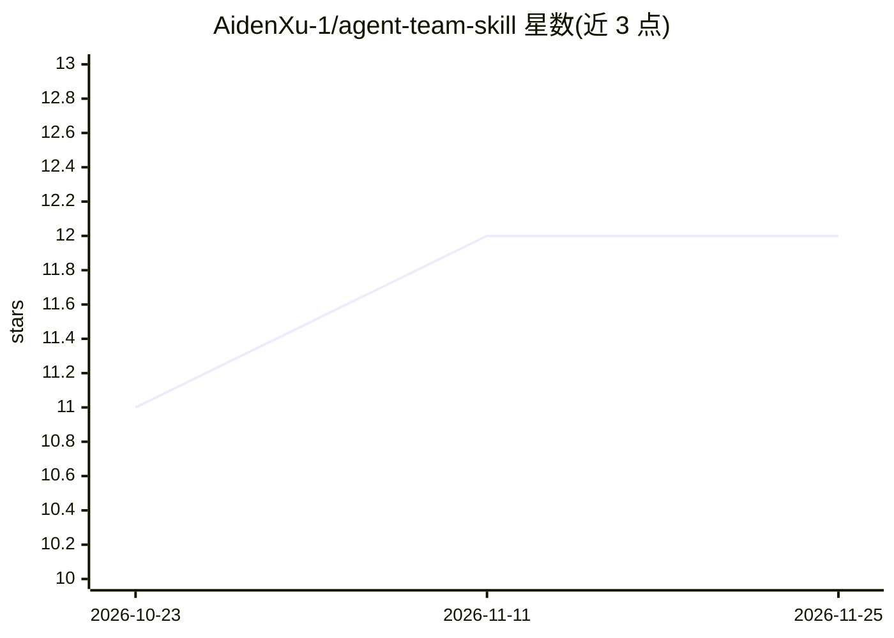

# AidenXu-1/agent-team-skill

⭐ 12 · Python · 推送 2026-09-16 · [GitHub](https://github.com/AidenXu-1/agent-team-skill) · [官网](https://github.com/AidenXu-1/agent-team-skill/releases/latest) · 个人维护 · 中文 README

**给 Codex 类 AI 的多会话部门制团队协作 Skill**

一套安装到宿主 skills 目录的 Codex Skill：用项目文件保存分工、任务状态、审核结论与接班上下文，把跨会话、跨部门的 AI 协作组织成管理层/执行层/审核层三层团队。提供 scaffold_team.py 生成协作层，以及任务事务、会话登记换班、事实日志等脚本工具；调度固定为 manual-degraded，auto 模式仅支持已授权的会话创建与短通知，不承诺无人值守或 Token 下降。本 Skill 只搭协作机制，不直接产出业务代码。依赖 Python 3，脚本仅用标准库。

## 筛选速览

| 维度 | 判定 | 备注 |
|---|---|---|
| AI 角色 | `ai-ecosystem` | LLM/agent 周边工具 |
| 许可风险 | `none` | — |
| 部署形态 | `None` |  |
| 模型依赖 | — | README 未给出锁定关系 |
| 硬件要求 | — | 无带数字的原话,不猜 |
| 安装摩擦 | `low` | 无编译、无系统依赖或容器化 |
| 成熟度 | — | 结构信号不足 |

## 能力要点

- 三层团队与四文档接班机制，跨会话恢复当前任务
- 单 owner、最多两个审核 gate 的原子任务事务
- 只写不读的事实日志，记录五类改变项目轨迹的事件
- 依赖 Python 3，脚本仅用标准库，无第三方运行时依赖

## 适用场景

- 让多个 AI 会话按部门分工接力完成项目任务
- 需要可审核、可接班的 AI 团队协作流程
- 按交付物类型配置最小必要的 Agent 团队角色

## 场景标签

`多智能体` · 领域:Agent 开发

## 证据(README 行号)

> L3: 把多 Agent 协作的真值写进项目文件：团队搭建、角色分工、会话路由、任务交接与协议修复。
> L30: 依赖 Python 3，两个脚本只用标准库，无第三方运行时依赖。整个目录作为一个 Skill 放到宿主的 skills 目录即可加载。
> L77: - 本 Skill 只搭协作机制，不替业务部门直接完成业务代码或产物

## 星数曲线

2026-10-23 11 → 2026-11-25 12（+1）

---
*卡片 v1 · prompt 1.4 · 生成 2026-11-18 · 置信度 high · 依据 README sha `06236e92b113` · [字段定义](../../DATASET.md)*
