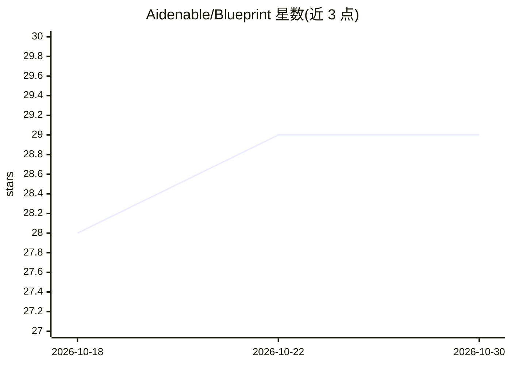

# Aidenable/Blueprint

⭐ 29 · Swift · MIT · 推送 2026-09-02 · [GitHub](https://github.com/Aidenable/Blueprint) · 个人维护

**macOS 数据库 ER 图绘制工具：无限画布草图转为 SQL**

面向 macOS 的实体关系图设计应用：在无限画布上以卡片形式定义表、字段、类型（PostgreSQL 类型集）、枚举与 CHECK 约束，字段间连线自动推断外键归属与连接表。支持导出 PostgreSQL DDL、SVG、PNG、Mermaid ERD、DBML 及 ALTER TABLE 迁移脚本，也可导入 pg_dump --schema-only 生成图。附带便签、代码片段、截图与画笔等白板元素。应用可作为 MCP server 运行，供 Claude 等 MCP 客户端编辑 schema。需 macOS 14+ 与 Swift 6 工具链从源码构建，文件保存为纯 JSON。

## 筛选速览

| 维度 | 判定 | 备注 |
|---|---|---|
| AI 角色 | `ai-enhanced` | 去掉 AI 部分产品仍成立 |
| 许可风险 | `permissive` | MIT |
| 部署形态 | `None` |  |
| 模型依赖 | — | README 未给出锁定关系 |
| 硬件要求 | — | 无带数字的原话,不猜 |
| 安装摩擦 | `low` | 无编译、无系统依赖或容器化 |
| 成熟度 | — | 结构信号不足 |

## 能力要点

- 无限画布绘制表结构并导出 PostgreSQL DDL 及多种格式（SVG/DBML/Mermaid/迁移脚本）
- 作为 MCP server 供 Claude 等 MCP 客户端编辑 schema
- 导入 pg_dump --schema-only 反向生成数据库图
- 内置 Quick Look 扩展与 blueprint:// 深度链接

## 适用场景

- 项目初期快速勾画数据库表结构并导出建表 SQL
- 接手遗留数据库时从 pg_dump 生成可视化关系图
- 让 AI agent 通过自然语言指令增改表并生成 SQL

## 场景标签

`代码生成` · 领域:编码与开发

## 证据(README 行号)

> L19: Blueprint is a small macOS app for that first sketch. It feels like a whiteboard — pan, zoom,
> L83: The app doubles as an MCP server, so Claude — or any other

## 星数曲线

2026-10-18 28 → 2026-10-30 29（+1）

---
*卡片 v1 · prompt 1.4 · 生成 2026-10-26 · 置信度 high · 依据 README sha `1946996f4270` · [字段定义](../../DATASET.md)*
