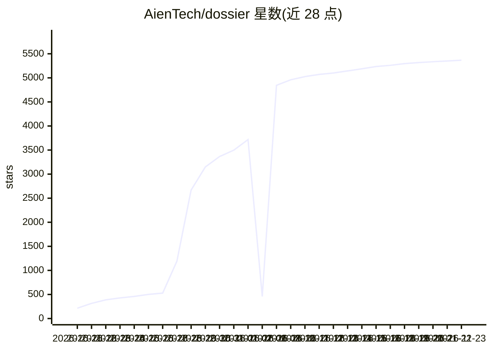

# AienTech/dossier

⭐ 5,367 · TypeScript · AGPL-3.0 · 推送 2026-11-19 · [GitHub](https://github.com/AienTech/dossier) · [官网](https://dossier.aien.me) · 组织维护

**自托管求职应用：从个人档案生成定制简历与求职信**

单用户自托管应用：将职业经历存为一个档案，为每个职位读取招聘信息、计算匹配度，并仅基于档案事实起草定制简历与求职信（缺项显示为差距而非编造），可在聊天中修改、导出 PDF，并从草稿到 offer 全程跟踪申请。支持本地模型（Ollama/LM Studio）或托管 API；Docker 部署需约 2GB 内存，也可用 SQLite 免数据库运行；仅限桌面浏览器、无多账户、界面仅英文。

## 筛选速览

| 维度 | 判定 | 备注 |
|---|---|---|
| AI 角色 | `ai-native` | 本体是模型或模型工具 |
| 许可风险 | `viral` | AGPL-3.0 |
| 部署形态 | `self-host` | docker 或自建部署 |
| 模型依赖 | local-ok | 支持本地模型 |
| 硬件要求 | — | 无带数字的原话,不猜 |
| 安装摩擦 | `low` | 无编译、无系统依赖或容器化 |
| 成熟度 | — | 结构信号不足 |

## 能力要点

- 仅基于档案事实起草简历与求职信，缺失项显示为差距
- 可选 Job agent 每日运行最多三个搜索，筛选打分职位但不代发申请
- MCP connector 可从 Claude 或 n8n 查询、打分与保存草稿
- 支持 PostgreSQL 或单文件 SQLite，Docker/CapRover/Coolify/Dokploy 多种部署方式

## 适用场景

- 为每个申请的职位生成贴合 JD 的简历和求职信
- 在一块看板上跟踪所有申请从草稿到 offer 的进度
- 用本地模型保证求职数据不出自 own 硬件
- 聚合多个招聘门户的职位并按档案打分

## 场景标签

`AI 写作` · 领域:内容生成

## 证据(README 行号)

> L13: Dossier keeps your career history in one profile and turns it into a clean resume. For every job you apply to, it r
> L15: It's for one person on a small server: one password, your data in your own PostgreSQL database (or a single SQLite 

## 星数曲线

2026-10-21 215 → 2026-11-23 5,367（+5,152）

---
*卡片 v1 · prompt 1.4 · 生成 2026-11-22 · 置信度 high · 依据 README sha `b4925de5d04a` · [字段定义](../../DATASET.md)*
