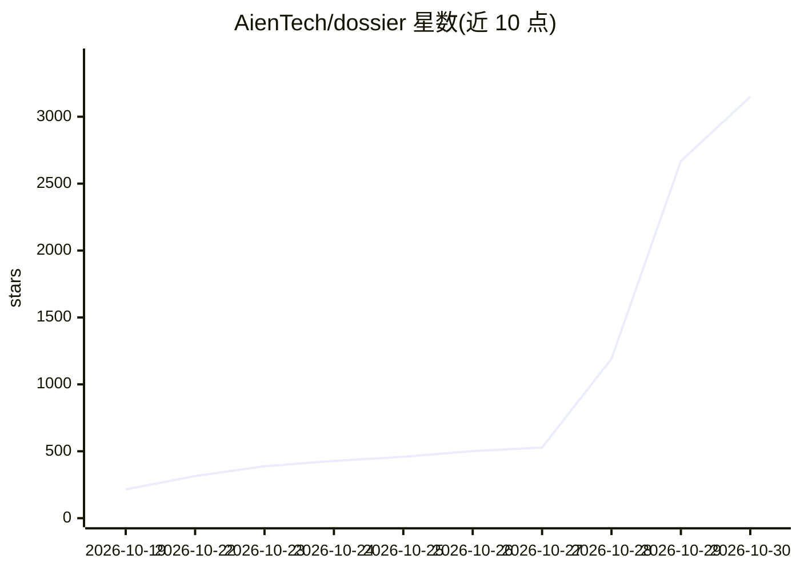

# AienTech/dossier

⭐ 3,149 · TypeScript · AGPL-3.0 · 推送 2026-10-29 · [GitHub](https://github.com/AienTech/dossier) · [官网](https://dossier.aien.me) · 个人维护

**自托管求职应用：一份档案生成定制简历与求职信并追踪投递**

面向单人使用的自托管 Web 应用（Next.js + PostgreSQL，Docker 部署）：集中维护职业档案，为每个职位读取招聘信息、展示匹配度，并基于档案事实起草定制简历与求职信（聊天式修改、PDF 导出）；另含职位搜索（JSearch/Adzuna/德国联邦劳工局）、每日职位 Agent、Gmail/Google Calendar 集成与投递看板追踪。AI 模型可选：Ollama/LM Studio 本地模型或 OpenAI 兼容 API、Anthropic、Mistral。限制：桌面浏览器、单用户、英文界面、单实例。

## 筛选速览

| 维度 | 判定 | 备注 |
|---|---|---|
| AI 角色 | `ai-native` | 本体是模型或模型工具 |
| 许可风险 | `viral` | AGPL-3.0 |
| 部署形态 | `self-host` | docker 或自建部署 |
| 模型依赖 | local-ok | 支持本地模型 |
| 硬件要求 | — | 无带数字的原话,不猜 |
| 安装摩擦 | `low` | 无编译、无系统依赖或容器化 |
| 成熟度 | — | 结构信号不足 |

## 能力要点

- 从档案事实生成定制简历与求职信，缺失项显示为差距而非编造
- 支持 Ollama/LM Studio 本地模型及 OpenAI 兼容/Anthropic/Mistral 托管 API
- 职位搜索、每日职位 Agent 与投递看板（draft 到 offer）
- 可选 Gmail/Calendar 集成：代发送、读回复并代拟答复

## 适用场景

- 我想在自己服务器上管理求职全流程，数据不出本地
- 粘贴招聘信息后自动得到匹配分析和定制简历/求职信
- 用本地 LLM 生成文档，保持档案隐私

## 场景标签

`AI 写作` · 领域:内容生成

## 证据(README 行号)

> L12: Dossier keeps your career history in one profile and turns it into a clean resume. For every job you apply to, it r
> L14: It's for one person on a small server: one password, your data in your own PostgreSQL database, and an AI model of 
> L30: - **New application:** paste a posting; Dossier pulls out the details and requirements, matches them against your p

## 星数曲线

2026-10-19 215 → 2026-10-30 3,149（+2,934）

---
*卡片 v1 · prompt 1.4 · 生成 2026-10-21 · 置信度 high · 依据 README sha `34c98f5db665` · [字段定义](../../DATASET.md)*
