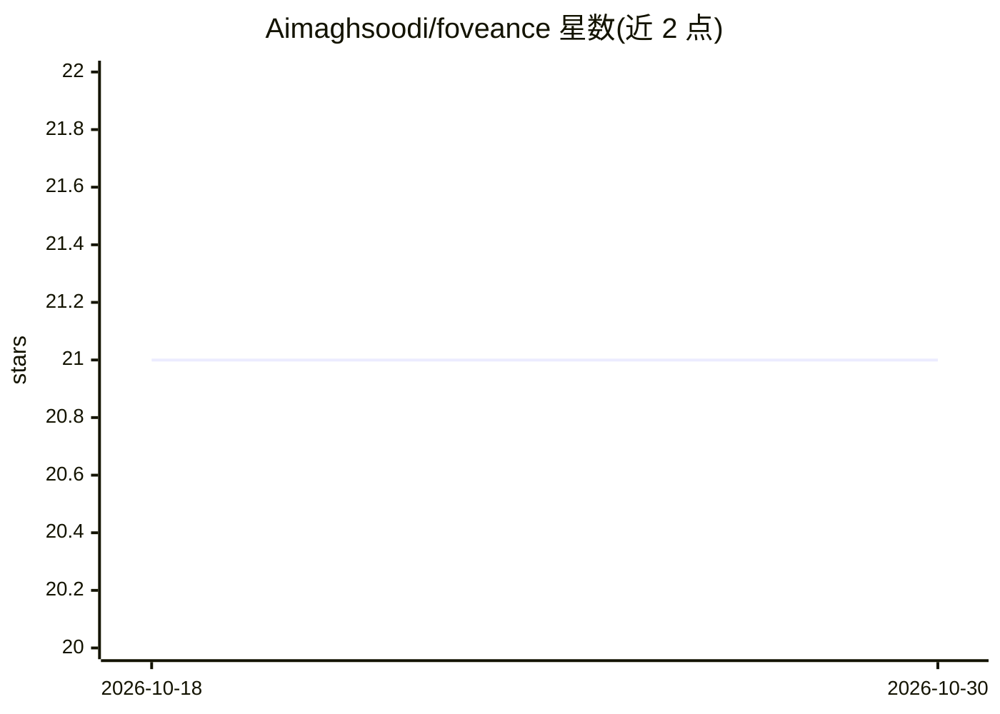

# Aimaghsoodi/foveance

⭐ 21 · Python · NOASSERTION · 推送 2026-07-16 · [GitHub](https://github.com/Aimaghsoodi/foveance) · [官网](https://pypi.org/project/foveance/) · 个人维护

**面向 LLM agent 的无损 token 压缩代理与 Python 库**

为 LLM agent 重复发送历史上下文的问题提供无损压缩编解码器：类似 gzip 的回引替换机制，将已出现过的重复文本替换为短引用，pack/unpack 完全可逆，不摘要、不改写、不丢弃信息。使用方式包括：foveance wrap 包装 Claude Code/Codex/Cursor/aider 等编码 agent；反向代理（Docker 或 CLI）兼容 OpenAI/Anthropic 协议与 Ollama/vLLM 上游；一行 Python compress()。默认无损压缩宣称节省最高 82% 输入 token，附加可选的预算上限分层保真 allocator。基座安装不含重量级依赖。

## 筛选速览

| 维度 | 判定 | 备注 |
|---|---|---|
| AI 角色 | `ai-ecosystem` | LLM/agent 周边工具 |
| 许可风险 | `none` | NOASSERTION |
| 部署形态 | `self-host` | docker 或自建部署 |
| 模型依赖 | local-ok | 支持本地模型 |
| 硬件要求 | — | 无带数字的原话,不猜 |
| 安装摩擦 | `low` | 无编译、无系统依赖或容器化 |
| 成熟度 | — | 结构信号不足 |

## 能力要点

- pack/unpack 完全可逆的无损 token 压缩编解码器
- 反向代理兼容 OpenAI Chat Completions/Responses 与 Anthropic Messages 协议，可代理 Ollama/vLLM 本地运行时
- foveance wrap 一条命令包装 Claude Code/Codex/Cursor/aider 等编码 agent，零代码改动
- 附带 tokens saved 仪表盘与 bench/ 下可复现的基准脚本

## 适用场景

- 给 Claude Code、Codex、Cursor 等编码 agent 降低输入 token 成本
- 在 OpenAI/Anthropic 兼容工具链中作为中间代理压缩上下文
- 在 Python 中对 OpenAI 风格消息列表做无损压缩
- 长轨迹 agent 会话超出预算时用可恢复的分层保真分配

## 场景标签

`模型网关` · 领域:Agent 开发

## 证据(README 行号)

> L129: `foveance wrap <tool>` is a convenience wrapper around a small reverse proxy you can also run
> L156: > and local runtimes like **Ollama / vLLM / LM Studio**. Foveance is **auth-free**: it adds no

## 星数曲线

2026-10-18 21 → 2026-10-30 21（+0）

---
*卡片 v1 · prompt 1.4 · 生成 2026-10-28 · 置信度 mid · 依据 README sha `76a7ea95c9c3` · [字段定义](../../DATASET.md)*
