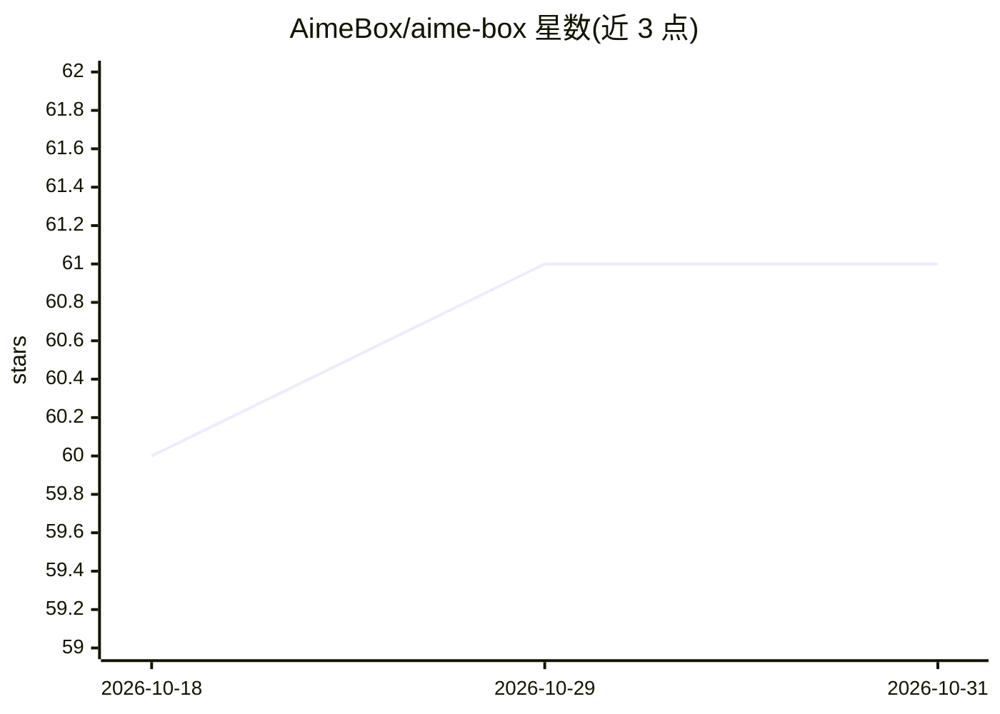

# AimeBox/aime-box

⭐ 61 · TypeScript · Apache-2.0 · 推送 2026-03-05 · [GitHub](https://github.com/AimeBox/aime-box) · 个人维护 · 中文 README

**多平台离线 AI Agent 聊天桌面客户端**

基于 Electron 与 LangChain.js 开发的多平台桌面 Chat 客户端，面向个人用户。支持接入 ollama、openai、deepseek、anthropic 等模型供应商，含本地知识库引擎（lancedb 向量检索、bge 重排序），支持 tool 调用、MCP 接入、a2a、多 agent（数据提取、代码助手、翻译助手），并内置本地语音识别/合成、OCR、背景消除等本地模型，目标尽量实现全离线本地可执行的智能 agent。开发需 Node 22，通过 npm 构建。

## 筛选速览

| 维度 | 判定 | 备注 |
|---|---|---|
| AI 角色 | `ai-native` | 本体是模型或模型工具 |
| 许可风险 | `permissive` | Apache-2.0 |
| 部署形态 | `None` |  |
| 模型依赖 | local-ok | 支持本地模型 |
| 硬件要求 | — | 无带数字的原话,不猜 |
| 安装摩擦 | `low` | 无编译、无系统依赖或容器化 |
| 成熟度 | — | 结构信号不足 |

## 能力要点

- 多模型供应商接入（ollama、openai、deepseek、anthropic 等）
- 本地知识库：lancedb 检索，支持 image/docx/doc/text/url 输入源
- 本地模型栈：语音识别/合成、OCR、说话人识别、背景消除
- MCP 与 a2a 支持，内置数据提取/代码/翻译等多个 agent

## 适用场景

- 在桌面端与多供应商模型对话并调用工具
- 搭建本地知识库做文档问答（目标尽量全离线）
- 用内置 agent 做文件数据提取或生成并执行 Python 脚本

## 场景标签

`聊天机器人` `文档问答` · 领域:对话与助手

## 证据(README 行号)

> L9: ### 一款基于 langchain + electron开发的多平台桌面端 Chat 客户端
> L11: 支持本地知识库，tool调用，多个智能agent调用
> L41: - 多个模型供应商支持 ollama、openai、deepseek、anthropic等等

## 星数曲线

2026-10-18 60 → 2026-10-31 61（+1）

---
*卡片 v1 · prompt 1.4 · 生成 2026-10-24 · 置信度 high · 依据 README sha `0ccd939e18e1` · [字段定义](../../DATASET.md)*
