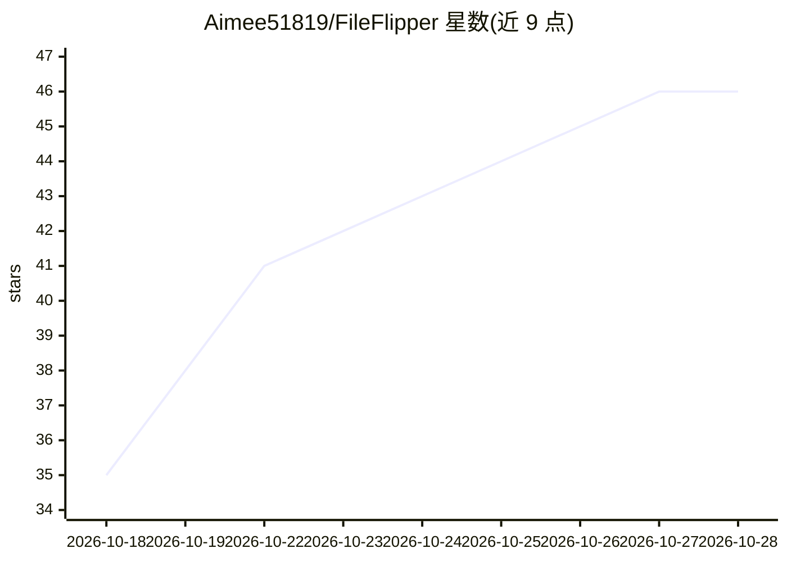

# Aimee51819/FileFlipper

⭐ 46 · C# · MIT · 推送 2026-10-16 · [GitHub](https://github.com/Aimee51819/FileFlipper) · [官网](https://fileflipper.app) · 个人维护 · 中文 README

**Mac/Windows 菜单栏文件转换工具：拖拽转格式与 Markdown**

驻留菜单栏（Mac）与通知区域（Windows）的免费开源文件转换工具：在 Finder/文件资源管理器中按住 Shift 拖动文件，弹出格式气泡即可转换图片、PDF、Office 文档、音视频等；Option/Ctrl+Shift 提供裁剪、压缩、合并、去元数据等工具。支持将 Word/PDF/PPT/Excel 一键转为 Markdown，扫描件通过系统自带 OCR（苹果/微软）识别中英文，抠图功能使用系统 AI 主体识别。全部处理在本地完成，不联网不上传；Mac 需 macOS 14+，Windows 需 Win10/11 64 位。

## 筛选速览

| 维度 | 判定 | 备注 |
|---|---|---|
| AI 角色 | `ai-enhanced` | 去掉 AI 部分产品仍成立 |
| 许可风险 | `permissive` | MIT |
| 部署形态 | `desktop` | 安装包/桌面程序 |
| 模型依赖 | — | README 未给出锁定关系 |
| 硬件要求 | — | 无带数字的原话,不猜 |
| 安装摩擦 | `medium` | 含编译或系统依赖之一 |
| 成熟度 | — | 结构信号不足 |

## 能力要点

- Word/PDF/PPT/Excel 一键转 Markdown，保留标题、列表与表格结构
- 扫描 PDF 经系统自带离线 OCR 识别文字（中英文）
- 抠图去背景：纯色背景直接去除，普通照片用系统 AI 识别主体
- 100% 本地处理，文件不上传、无需联网

## 适用场景

- 把文档转成 Markdown 再粘贴给 AI，减少 token 消耗
- 不打开任何软件在 Finder/资源管理器里快速转换文件格式
- 对图片/PDF/视频做压缩、裁剪、合并、去隐私等轻量处理
- 离线处理敏感文档，不经过在线转换网站

## 场景标签

`OCR` `文档解析` `图像视频处理` · 领域:知识与检索

## 证据(README 行号)

> L26: FileFlipper 是一个免费、开源的文件转换小工具，**Mac 和 Windows 都能用**。装好之后，你**不需要打开它的窗口**，它安安静静待在屏幕角落：Mac 上在右上角的菜单栏，Windows 上在右下角的通知区域
> L153: ||抠图（Cutout）|自动抠图，去掉背景，保存为透明 PNG。纯色背景（白底图标、Logo、截图、白底商品图）会被干净地去掉，不留白边；普通照片用苹果系统自带的 AI 识别主体|
> L159: ||文字（Text）|提取文字，存成 TXT。扫描件、拍照转成的 PDF 也可以：会自动用苹果自带的文字识别（OCR），支持中文和英文|

## 星数曲线

2026-10-18 35 → 2026-10-28 46（+11）

---
*卡片 v1 · prompt 1.4 · 生成 2026-10-25 · 置信度 high · 依据 README sha `12b91d08c931` · [字段定义](../../DATASET.md)*
