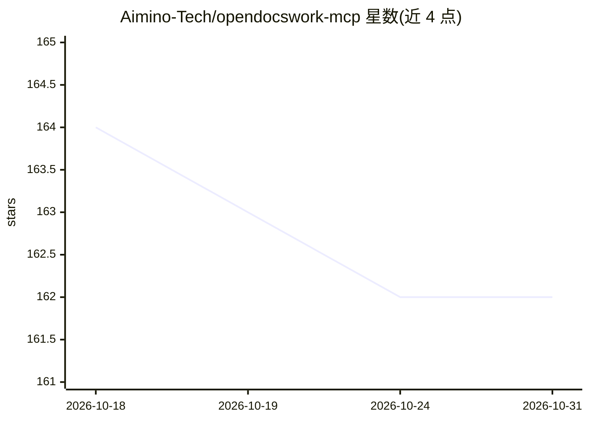

# Aimino-Tech/opendocswork-mcp

⭐ 162 · Rust · GPL-3.0 · 推送 2026-09-30 · [GitHub](https://github.com/Aimino-Tech/opendocswork-mcp) · [官网](https://github.com/Aimino-Tech/opendocwork-mcp) · 组织维护

**Rust 实现的 Office/PDF 文档处理 MCP 服务器**

以 Rust 编写的本地优先 MCP 服务器，向 Claude Desktop、Cursor、VS Code Copilot 等 MCP 客户端提供 Office 文档读写工具集：Excel/Word/PPT 的创建、写入、格式化、图表与数据透视表，PDF 的读取、AcroForm/XFA 表单填写、坐标文本覆盖与布局分析，以及技能系统（skill_run 等）和一致性检查引擎。通过 cargo install 安装或从 GitHub Releases 下载，也可用 cargo build 从源码构建。README 附带与 Python 方案的基准对比数据和示例文档展示页。

## 筛选速览

| 维度 | 判定 | 备注 |
|---|---|---|
| AI 角色 | `ai-ecosystem` | LLM/agent 周边工具 |
| 许可风险 | `viral` | GPL-3.0 |
| 部署形态 | `library` | 以包/库形式分发 |
| 模型依赖 | — | README 未给出锁定关系 |
| 硬件要求 | — | 无带数字的原话,不猜 |
| 安装摩擦 | `medium` | 含编译或系统依赖之一 |
| 成熟度 | — | 结构信号不足 |

## 能力要点

- Excel/Word/PPT 全套读写工具（创建、写入、格式化、图表、透视表等）
- PDF 表单填写（AcroForm/XFA）与平面 PDF 坐标文本覆盖
- 技能系统与一致性检查引擎
- cargo install 一条命令安装，支持 stdio 传输接入 MCP 客户端

## 适用场景

- 让 Claude/Cursor 等 AI 客户端直接生成 Excel 报表、Word 合同、PPT 演示稿
- 自动化填写银行、税务等 PDF 表单
- 把本地 Office 文档转为 Markdown/JSON 供 LLM 阅读

## 场景标签

`文档解析` · 领域:知识与检索

## 证据(README 行号)

> L8: **Rust-native MCP server for Office document processing (Excel, Word, PowerPoint, PDF).**
> L40:   "mcpServers": {

## 星数曲线

2026-10-18 164 → 2026-10-31 162（-2）

---
*卡片 v1 · prompt 1.4 · 生成 2026-10-22 · 置信度 high · 依据 README sha `e013fe6c9f64` · [字段定义](../../DATASET.md)*
