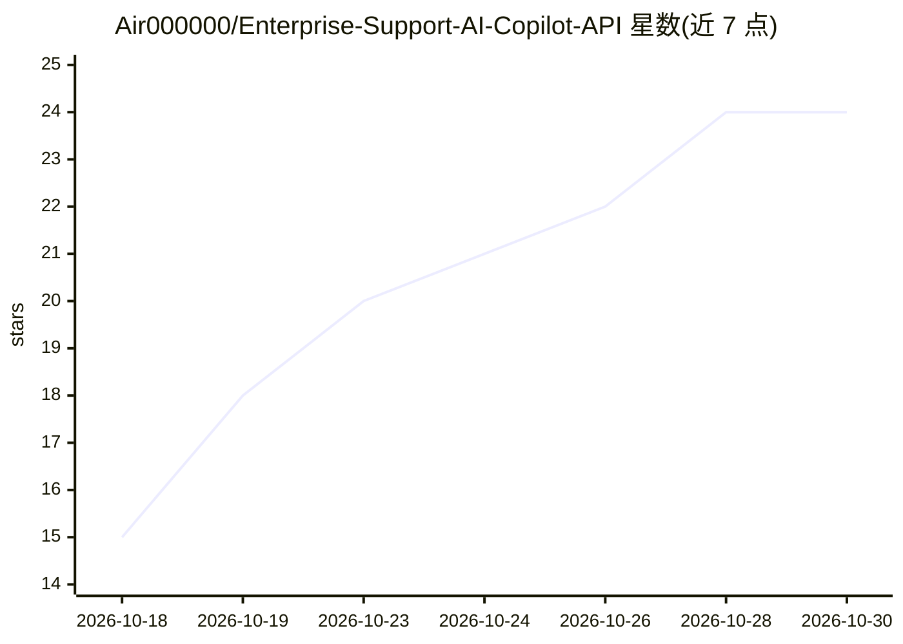

# Air000000/Enterprise-Support-AI-Copilot-API

⭐ 24 · Python · 推送 2026-10-29 · [GitHub](https://github.com/Air000000/Enterprise-Support-AI-Copilot-API) · 个人维护 · 中文 README

**企业技术支持场景的 RAG 问答与受控工单升级后端**

面向企业技术支持场景的 FastAPI 后端：从 TechQA 技术支持知识库（28,481 篇 Technote）检索证据，经 /rag/search 与 /rag/ask 返回带来源的回答或在上下文不足时拒答；对需进一步处理的问题，通过 search_kb/classify_ticket/create_ticket 三个工具执行预览-确认加人工审批后才真实建单，并用 AgentOps 记录运行与审批链路。默认在线运行时为 Dense Chroma 检索，Hybrid（Dense+BM25+RRF+qwen3-rerank）与实验问答路径为默认关闭的可选配置，依赖 DashScope embedding/rerank/生成服务。项目自述当前不接受为已验收发布版。

## 筛选速览

| 维度 | 判定 | 备注 |
|---|---|---|
| AI 角色 | `ai-native` | 本体是模型或模型工具 |
| 许可风险 | `none` | — |
| 部署形态 | `self-host` | docker 或自建部署 |
| 模型依赖 | — | README 未给出锁定关系 |
| 硬件要求 | — | 无带数字的原话,不猜 |
| 安装摩擦 | `low` | 无编译、无系统依赖或容器化 |
| 成熟度 | `idea` | |

## 能力要点

- RAG 问答带结构化 sources 返回与低相关拒答
- 受控工单 Agent：预览-确认分离，服务端冻结审批草稿，并发决策仅一次成功
- TechQA 语料与冻结 TRAIN/DEV 评测（Recall@K / MRR、生成/拒答评测框架）
- AgentOps 记录工具调用、审批与检索轨迹及聚合指标

## 适用场景

- 企业 IT 技术支持中自动检索知识库回答问题并附来源
- 上下文不足时拒答并升级为人工确认的工单流程
- 对技术支持问答系统做检索/拒答/失败归因的持续评测

## 场景标签

`RAG` `模型评测` · 领域:评测与运维

## 证据(README 行号)

> L5: 面向**企业技术支持**场景，构建知识检索、回答 / 拒答与工单升级一体化的 **RAG + 受控工单 Agent 后端**。
> L7: 系统首先从技术支持知识库检索相关证据，返回带来源的回答或在上下文不足时拒答；对于需要进一步处理的问题，通过工单分类、预览和人工确认后再执行真实建单，并以 AgentOps 记录关键运行与审批链路。这里的目标不是让模型直接接管业务状态

## 星数曲线

2026-10-18 15 → 2026-10-30 24（+9）

---
*卡片 v1 · prompt 1.4 · 生成 2026-10-28 · 置信度 mid · 依据 README sha `7c8823c50c2a` · [字段定义](../../DATASET.md)*
