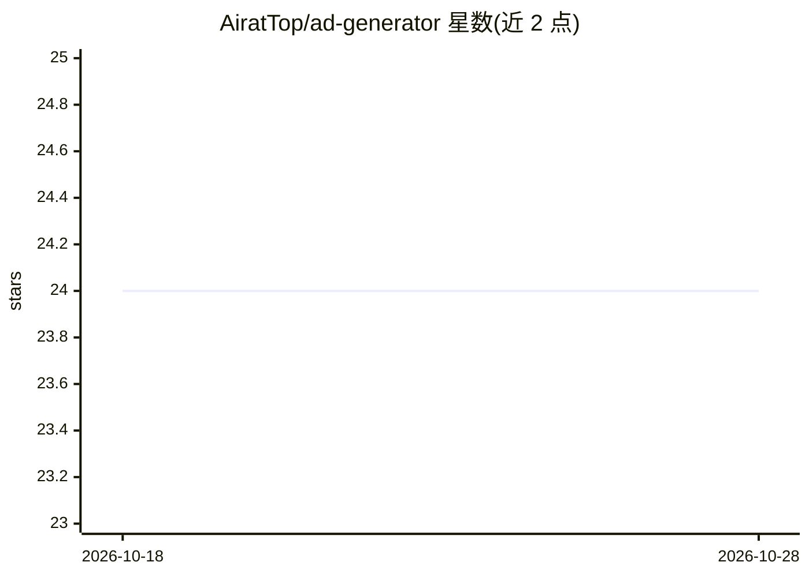

# AiratTop/ad-generator

⭐ 24 · PHP · Apache-2.0 · 推送 2026-09-01 · [GitHub](https://github.com/AiratTop/ad-generator) · [官网](https://random.airat.top) · 个人维护

**WordPress 文本随机化插件：用模板语法批量生成伪唯一广告文案**

提供 WordPress 插件与独立 PHP CLI 两种形式的文本随机化工具：用户在基础文本上应用替代、可选、乱序、分隔符乱序等模板语法（支持无限嵌套与随机数字插入），由程序组合出大量可读的伪唯一变体，示例模板可生成 24,576 种变体。面向需要在多个目录/平台提交不同描述的发布者。插件需 WordPress 与 PHP 8.3+，CLI 版本直接以 php 运行脚本，支持指定模板文件、输出数量与输出文件。生成基于规则组合，不涉及模型调用。

## 筛选速览

| 维度 | 判定 | 备注 |
|---|---|---|
| AI 角色 | `ai-enhanced` | 去掉 AI 部分产品仍成立 |
| 许可风险 | `permissive` | Apache-2.0 |
| 部署形态 | `None` |  |
| 模型依赖 | — | README 未给出锁定关系 |
| 硬件要求 | — | 无带数字的原话,不猜 |
| 安装摩擦 | `low` | 无编译、无系统依赖或容器化 |
| 成熟度 | — | 结构信号不足 |

## 能力要点

- 替代/乱序/分隔符乱序等模板语法，支持无限嵌套
- 插件与独立 PHP CLI 两种运行方式
- %rand% 随机数字与特殊字符转义
- 面向批量伪唯一内容生成，保持可读性

## 适用场景

- 向多个目录提交网站时为每个条目生成不同描述
- 批量制作同一利基的多版广告文案
- 不装 WordPress 时用 CLI 批量生成文本变体

## 场景标签

 · 领域:内容生成/WordPress 插件

## 证据(README 行号)

> L9: Professional text randomizer and ad generator by AiratTop.
> L88: You can run the script via CLI, without installing the WordPress plugin — faster and unrestricted.

## 星数曲线

2026-10-18 24 → 2026-10-28 24（+0）

---
*卡片 v1 · prompt 1.4 · 生成 2026-10-27 · 置信度 mid · 依据 README sha `7f201a8a1333` · [字段定义](../../DATASET.md)*
