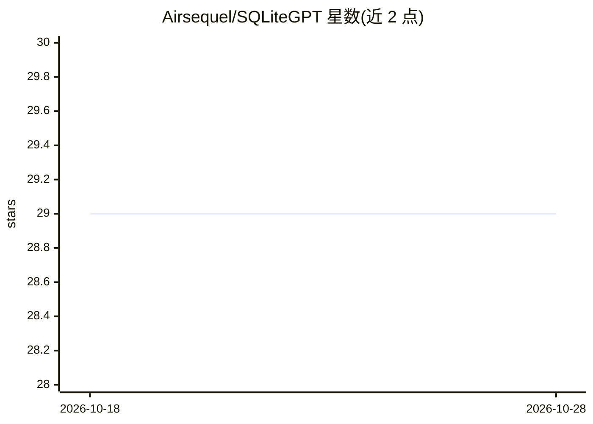

# Airsequel/SQLiteGPT

⭐ 29 · Rust · 推送 2026-05-27 · [GitHub](https://github.com/Airsequel/SQLiteGPT) · 组织维护

**SQLite 扩展：在 SQL 中直接调用 OpenAI ChatGPT 的 gpt() 函数**

用 Rust（rusqlite）实现的 SQLite 可加载扩展，暴露 gpt() SQL 函数，使 SQL 查询可直接调用 OpenAI chat completions API。通过环境变量配置 API key、模型与缓存开关；同会话内相同 (model, prompt) 的响应会被进程内缓存。函数为同步调用，每行阻塞于 HTTP 往返；注册为 SQLITE_DIRECTONLY，不能在视图、触发器、索引等场景调用，以防打开恶意数据库文件触发网络请求与 API 消耗。需自行 make build 编译为对应平台动态库。

## 筛选速览

| 维度 | 判定 | 备注 |
|---|---|---|
| AI 角色 | `ai-ecosystem` | LLM/agent 周边工具 |
| 许可风险 | `none` | — |
| 部署形态 | `None` |  |
| 模型依赖 | — | README 未给出锁定关系 |
| 硬件要求 | — | 无带数字的原话,不猜 |
| 安装摩擦 | `low` | 无编译、无系统依赖或容器化 |
| 成熟度 | — | 结构信号不足 |

## 能力要点

- SQL 内直接调用 gpt() 查询 OpenAI chat completions
- 进程内按 (model, prompt) 缓存响应，可设 SQLITEGPT_NO_CACHE 禁用
- SQLITE_DIRECTONLY 限制调用位置，防止恶意数据库文件触发网络调用
- 60 秒全局超时避免请求无限挂起

## 适用场景

- 在 SQL 分析流程中内联生成 LLM 输出
- 为已有 SQLite 数据管道添加 GPT 查询能力
- 实验性地在查询中混合结构化数据与模型生成

## 场景标签

`数据分析` · 领域:效率与自动化

## 证据(README 行号)

> L3: SQLite loadable extension that exposes
> L4: a `gpt()` SQL function for querying OpenAI's chat completions API directly

## 星数曲线

2026-10-18 29 → 2026-10-28 29（+0）

---
*卡片 v1 · prompt 1.4 · 生成 2026-10-26 · 置信度 high · 依据 README sha `c1163e31937f` · [字段定义](../../DATASET.md)*
