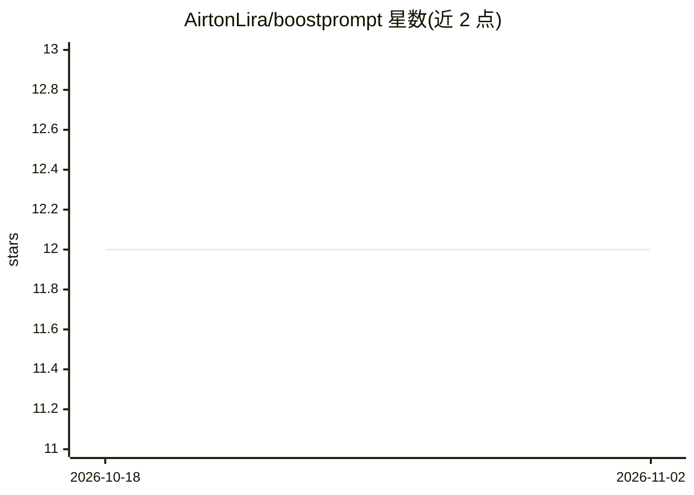

# AirtonLira/boostprompt

⭐ 12 · Python · MIT · 推送 2026-08-23 · [GitHub](https://github.com/AirtonLira/boostprompt) · [官网](https://airtonlira.github.io/boostprompt) · 个人维护

**通过 LLM 自适应访谈把需求整理为实现用 Markdown 提示词**

BoostPrompt 以 LLM 驱动的结构化需求发现为核心：通过 30-50 个根据先前回答自适应的提问（含备选方案、权衡与建议），最终生成单一自包含的 Markdown 实现提示词，包含需求、决策、验收标准与执行计划。提供两种使用方式：基于 Python + uv 的本地 CLI/TUI（会话持久化于 DuckDB，可恢复与继续），以及可安装到 Claude Code 和 Codex 的 skills。支持 OpenAI 兼容端点（LiteLLM/OpenRouter/vLLM/OpenAI），可选 Exa 技术检索，并有本地质量指标面板。

## 筛选速览

| 维度 | 判定 | 备注 |
|---|---|---|
| AI 角色 | `ai-native` | 本体是模型或模型工具 |
| 许可风险 | `permissive` | MIT |
| 部署形态 | `library` | 以包/库形式分发 |
| 模型依赖 | local-ok | 支持本地模型 |
| 硬件要求 | — | 无带数字的原话,不猜 |
| 安装摩擦 | `low` | 无编译、无系统依赖或容器化 |
| 成熟度 | — | 结构信号不足 |

## 能力要点

- 30-50 个自适应问题的发现访谈，输出单一自包含实现提示词
- 本地 CLI/TUI 会话持久化于 DuckDB，支持恢复与续谈
- 可安装为 Claude Code 与 Codex 的 skills，在对话内执行相同发现流程
- 本地确定性质量指标：上下文覆盖、决策清晰度、提示词就绪度

## 适用场景

- 在动手开发前通过 AI 访谈把模糊想法变成完整实现提示词
- 生成发给客户的纯问题清单以收集需求
- 在 Claude Code 或 Codex 会话内直接执行需求发现

## 场景标签

`提示工程` · 领域:Agent 开发

## 证据(README 行号)

> L7: O **BoostPrompt** conduz o levantamento de requisitos com perguntas adaptativas,
> L32: - Entrevistas de discovery com **30 a 50 perguntas**, adaptadas às respostas anteriores;

## 星数曲线

2026-10-18 12 → 2026-11-02 12（+0）

---
*卡片 v1 · prompt 1.4 · 生成 2026-11-01 · 置信度 mid · 依据 README sha `b1bf0f199daf` · [字段定义](../../DATASET.md)*
