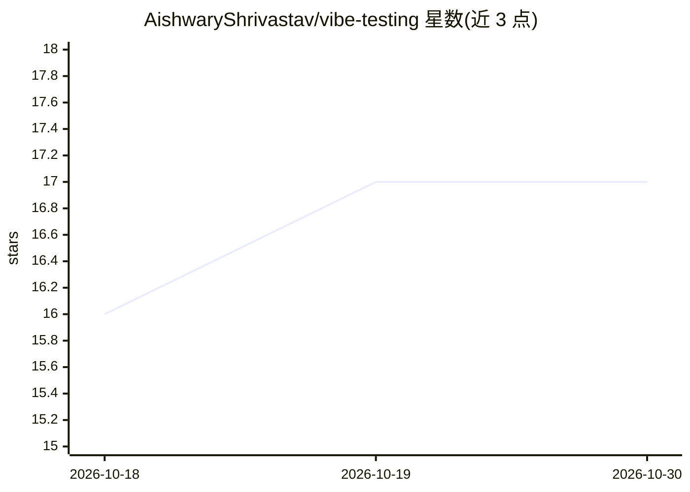

# AishwaryShrivastav/vibe-testing

⭐ 17 · TypeScript · MIT · 推送 2026-10-15 · [GitHub](https://github.com/AishwaryShrivastav/vibe-testing) · [官网](https://testing.tfgstudio.com/) · 个人维护

**给 AI 编程代理的代码感知浏览器测试 MCP 工具集**

面向 AI 编程代理的测试工具：读取代码库提取真实路由与字段名，在 Playwright 真实浏览器中执行测试，跨运行记忆回归（run-snapshot 与 route-manifest 差分），生成人类可读的 HTML QA 报告。以 MCP server 形式向编辑器（Claude Code、Cursor、Windsurf、VS Code Copilot、Roo Code）提供 14 个测试工具，也可独立 CLI 使用；工具内部不调用 LLM，判定采用启发式规则（URL 变化、toast、API 错误），无需 API key。另含 Agent Plugin 形式的 release-qa 技能。

## 筛选速览

| 维度 | 判定 | 备注 |
|---|---|---|
| AI 角色 | `ai-ecosystem` | LLM/agent 周边工具 |
| 许可风险 | `permissive` | MIT |
| 部署形态 | `self-host` | docker 或自建部署 |
| 模型依赖 | — | README 未给出锁定关系 |
| 硬件要求 | — | 无带数字的原话,不猜 |
| 安装摩擦 | `low` | 无编译、无系统依赖或容器化 |
| 成熟度 | — | 结构信号不足 |

## 能力要点

- 14 个 MCP 测试工具（扫描代码库、执行场景、覆盖率、报告等）
- 跨运行回归记忆：run-snapshot 与 route-manifest 差分输出 Regression/Fixed/New
- 工具内部零 LLM 调用，启发式判定，无需 API key
- 支持 Claude Code/Cursor/Windsurf/VS Code Copilot/Roo Code 编辑器配置

## 适用场景

- 让 AI 编程代理基于真实路由和字段名对 Web 应用做端到端测试
- 每次运行后查看哪些路由修复、哪些回归
- 修复 bug 后让代理验证登录等流程并给出截图证据

## 场景标签

`浏览器自动化` · 领域:效率与自动化

## 证据(README 行号)

> L17: vibe-testing reads your codebase so tests use your real routes and field names, runs them in a real Playwright brow
> L45: **2. Zero LLM calls inside the tool.** Pass/fail verification is heuristic: URL changes, toast detection, API error
> L182: 14 tools available to your AI editor after setup:

## 星数曲线

2026-10-18 16 → 2026-10-30 17（+1）

---
*卡片 v1 · prompt 1.4 · 生成 2026-10-30 · 置信度 mid · 依据 README sha `ee06f6b2a089` · [字段定义](../../DATASET.md)*
