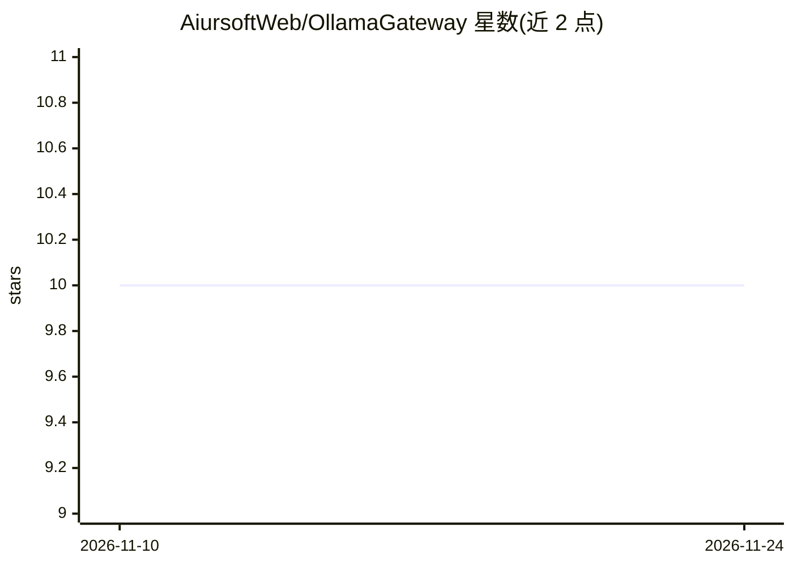

# AiursoftWeb/OllamaGateway

⭐ 10 · C# · NOASSERTION · 推送 2026-11-22 · [GitHub](https://github.com/AiursoftWeb/OllamaGateway) · [官网](https://ollama.aiursoft.com/) · 组织维护

**为 Ollama 添加企业级鉴权、审计与虚拟模型的 API 网关**

部署在 Ollama 前面的网关服务，提供 Bearer Token 鉴权、多 API Key 管理、请求/响应审计、限流、虚拟模型覆盖、多后端负载均衡与分级回退等原生 Ollama 未包含的功能。支持 Ollama 原生、OpenAI Chat Completions/Responses、Anthropic Messages 四种协议的翻译与转发，同方言请求走透明直通路径。每次请求写入 ClickHouse，附带 Grafana 仪表盘模板；提供 Docker 安装与 .NET 源码运行两种方式。

## 筛选速览

| 维度 | 判定 | 备注 |
|---|---|---|
| AI 角色 | `ai-ecosystem` | LLM/agent 周边工具 |
| 许可风险 | `none` | NOASSERTION |
| 部署形态 | `self-host` | docker 或自建部署 |
| 模型依赖 | local-ok | 支持本地模型 |
| 硬件要求 | — | 无带数字的原话,不猜 |
| 安装摩擦 | `low` | 无编译、无系统依赖或容器化 |
| 成熟度 | — | 结构信号不足 |

## 能力要点

- 四种客户端协议（Ollama/OpenAI/Anthropic）解码为中立表示后转发至物理后端
- Bearer Token 鉴权、多 API Key、请求审计与限流
- 虚拟模型覆盖、多后端负载均衡与分级回退
- 请求日志写入 ClickHouse 并提供 Grafana 仪表盘模板

## 适用场景

- 团队共享 Ollama 时需要 API 鉴权与限流
- 生产部署中审计所有请求与响应
- 一个网关同时服务多种 OpenAI/Anthropic 兼容客户端
- 多后端间做负载均衡与故障回退

## 场景标签

`模型网关` · 领域:Agent 开发

## 证据(README 行号)

> L21: Native Ollama is great for personal use, but it lacks the enterprise features required for team collaboration and p
> L123: - Ollama native (`/api/chat`)
> L128: Requests are decoded into a protocol-neutral representation and then encoded for the selected physical backend. Re

## 星数曲线

2026-11-10 10 → 2026-11-24 10（+0）

---
*卡片 v1 · prompt 1.4 · 生成 2026-11-20 · 置信度 high · 依据 README sha `e216f79d5c2d` · [字段定义](../../DATASET.md)*
