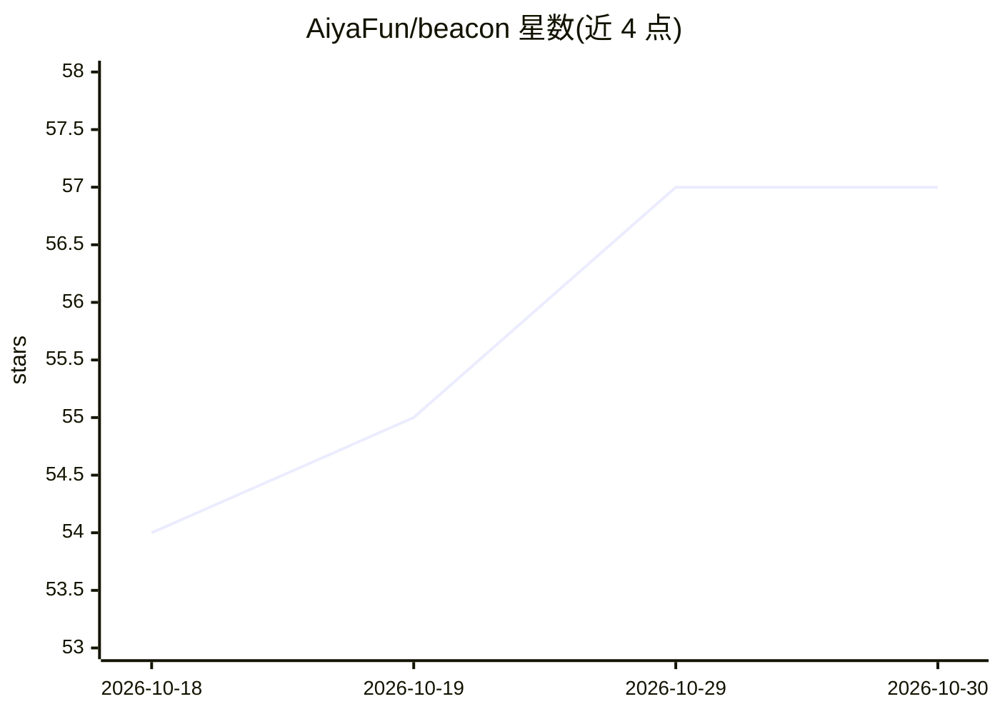

# AiyaFun/beacon

⭐ 57 · TypeScript · AGPL-3.0 · 推送 2026-09-20 · [GitHub](https://github.com/AiyaFun/beacon) · [官网](https://beacon.iyunci.cn) · 个人维护 · 中文 README

**给创作者的多平台选题创作 SaaS：热榜、竞对、AI 选题与发布闭环**

面向自媒体创作者与内容团队的多平台内容运营平台：聚合微博/抖音/B站等七源热榜并 AI 聚类去重，跨平台追踪竞对账号，12 位 AI 人物智囊团评审选题并给切入建议，创作工坊支持 AI 起稿、一稿多平台改写、事实漂移检测与 AIGC 标识，配四级敏感词合规扫描、数据看板与浏览器插件回填。模型接任意 OpenAI 兼容端点。提供在线 SaaS、桌面客户端与整机版（本地 SQLite）三种形态；README 自述 agent 只是其中一层，与通用 agent 运行时非替代关系，自带 MCP Server 可被外部 agent 调用。

## 筛选速览

| 维度 | 判定 | 备注 |
|---|---|---|
| AI 角色 | `ai-enhanced` | 去掉 AI 部分产品仍成立 |
| 许可风险 | `dual` | AGPL-3.0 |
| 部署形态 | `desktop` | 安装包/桌面程序 |
| 模型依赖 | — | README 未给出锁定关系 |
| 硬件要求 | — | 无带数字的原话,不猜 |
| 安装摩擦 | `low` | 无编译、无系统依赖或容器化 |
| 成熟度 | — | 结构信号不足 |

## 能力要点

- 七源热榜聚合 + 竞对监控 + 12 位 AI 智囊团选题评审（六维评分）
- 一稿多平台改写、去 AI 味、事实漂移检测与双 AIGC 标识
- 任意 OpenAI 兼容模型端点，不绑定单一供应商
- 三种形态：在线 SaaS / 桌面客户端 / 整机版本地 SQLite 私有部署

## 适用场景

- 每天获得一份带理由的多平台选题推荐
- 跨平台监控竞对账号动态并回流数据看板
- 一稿改写成抖音/小红书/公众号等平台风格并做敏感词合规检测
- 把选题到复盘的内容流水线在一个工作台内跑完

## 场景标签

`AI 写作` `网页抓取` · 领域:效率与自动化

## 证据(README 行号)

> L16:  面向创作者和内容团队的多平台选题创作 SaaS。
> L119: 一句话：**那两个是通用 agent 运行时，烽火台是内容运营的垂直产品**。它们给你一个「什么都能干」的助手，
> L120: 干什么由你交代；烽火台开箱就是热榜、竞对、选题、起稿、合规、发布、复盘这一条线，agent 只是其中一层。

## 星数曲线

2026-10-18 54 → 2026-10-30 57（+3）

---
*卡片 v1 · prompt 1.4 · 生成 2026-10-24 · 置信度 high · 依据 README sha `a42c9a7f28d3` · [字段定义](../../DATASET.md)*
