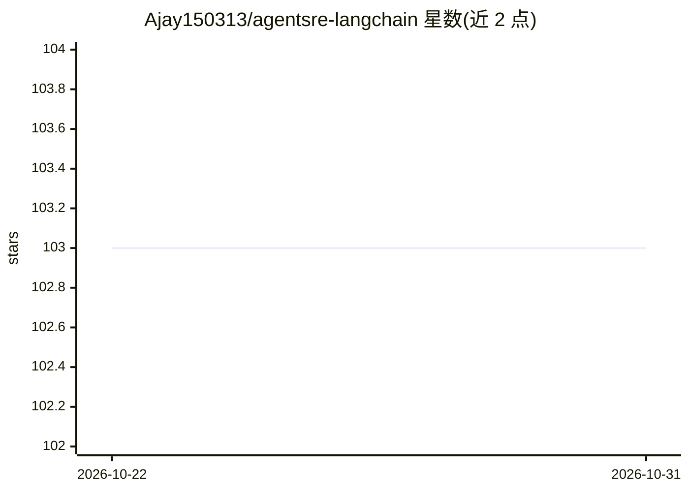

# Ajay150313/agentsre-langchain

⭐ 103 · Python · NOASSERTION · 推送 2026-10-20 · [GitHub](https://github.com/Ajay150313/agentsre-langchain) · 个人维护

**LangChain agent 的语义 SLI 监控库：量化决策质量与工具效率**

面向生产环境 LangChain agent 的 Python 监控库，通过 @monitor_agent 装饰器捕获每次执行，从 agent 输出中提取置信度、工具调用次数、token 与成本，计算四个语义 SLI：决策质量率 DQR、工具调用效率 TIE、人工升级率 HER、队列深度漂移 AQDD，并给出分环境（开发/预发/生产）的 SLO 起步阈值。装饰器将运行记录写入 MetricsCollector，可在测试中注入自定义 collector，可选接入 agentsre 转发 TaskRecord；DuplicateToolCallGuard 阻止超时重试重复调用同一工具。附带 5 个示例与供编码 agent 使用的 SKILL.md。

## 筛选速览

| 维度 | 判定 | 备注 |
|---|---|---|
| AI 角色 | `ai-ecosystem` | LLM/agent 周边工具 |
| 许可风险 | `permissive` | NOASSERTION |
| 部署形态 | `library` | 以包/库形式分发 |
| 模型依赖 | — | README 未给出锁定关系 |
| 硬件要求 | — | 无带数字的原话,不猜 |
| 安装摩擦 | `low` | 无编译、无系统依赖或容器化 |
| 成熟度 | — | 结构信号不足 |

## 能力要点

- 装饰器捕获执行并计算 DQR/TIE/HER/AQDD 四个语义 SLI
- 从输出提取置信度、工具调用数、token 与成本指标
- 可注入自定义 MetricsCollector 便于测试
- DuplicateToolCallGuard 防止超时重试重复调用工具

## 适用场景

- 监控生产 LangChain agent 的决策质量而非仅 HTTP 状态
- 追踪 agent 工具调用效率与成本
- 为可靠性 SLO 设定观测基线

## 场景标签

`LLM 可观测性` · 领域:评测与运维

## 证据(README 行号)

> L3: **Semantic SLI monitoring for LangChain agents** — Track Decision Quality, Tool Efficiency, Escalations, and Queue D
> L34: The decorator records each run into a `MetricsCollector`. `get_metrics()` reads that collector.

## 星数曲线

2026-10-22 103 → 2026-10-31 103（+0）

---
*卡片 v1 · prompt 1.4 · 生成 2026-10-23 · 置信度 high · 依据 README sha `3d789a27ab39` · [字段定义](../../DATASET.md)*
