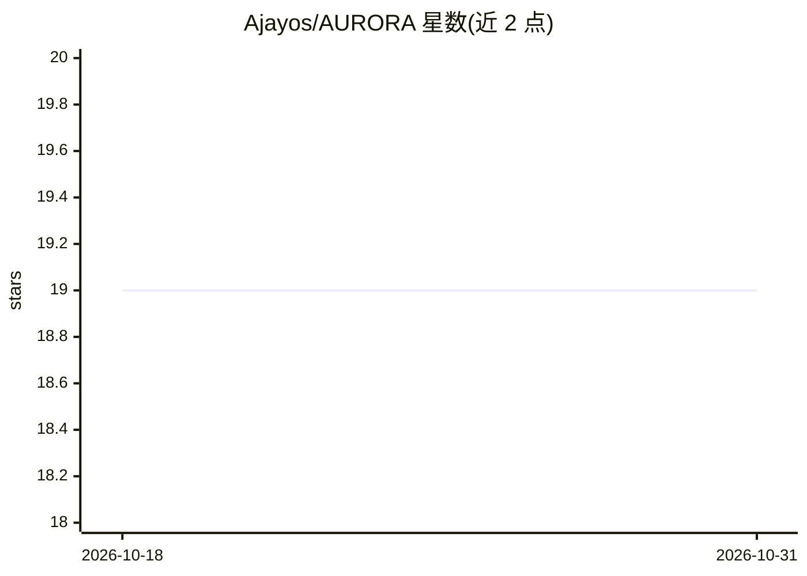

# Ajayos/AURORA

⭐ 19 · Dockerfile · Apache-2.0 · 推送 2026-05-06 · [GitHub](https://github.com/Ajayos/AURORA) · [官网](https://cosmos-aurora.github.io/) · 个人维护

**TypeScript/Node.js 多平台聊天机器人，接入 WhatsApp/Telegram/Instagram**

Aurora 是由 Ajay O S 个人维护、归属于 Cosmos-Aurora 组织的聊天机器人项目，使用 TypeScript 与 Node.js 开发。README 声称通过项目作者自建的专用 API 接入 WhatsApp、Telegram 与 Instagram，提供多语言支持（JavaScript、C、C++、Batch、Shell、Express）、自动化代码安全检查、自动发布流程，并支持插件与附加包（位于 Cosmos-Aurora/metadata 仓库）。README 未给出具体安装命令，安装与使用指引指向外部 GitHub Page 与 wiki。当前版本 v5.2.4，MIT 许可。

## 筛选速览

| 维度 | 判定 | 备注 |
|---|---|---|
| AI 角色 | `ai-native` | 本体是模型或模型工具 |
| 许可风险 | `permissive` | Apache-2.0 |
| 部署形态 | `None` |  |
| 模型依赖 | — | README 未给出锁定关系 |
| 硬件要求 | — | 无带数字的原话,不猜 |
| 安装摩擦 | `low` | 无编译、无系统依赖或容器化 |
| 成熟度 | — | 结构信号不足 |

## 能力要点

- 通过项目作者自建 API 接入 WhatsApp、Telegram 与 Instagram
- 支持插件与 Cosmos-Aurora/metadata 包仓库扩展功能
- 自动化代码安全检查与自动发布流程
- TypeScript/Node.js 实现，v5.2.4，MIT 许可

## 适用场景

- 在 WhatsApp/Telegram/Instagram 上运行统一的多平台聊天机器人
- 通过插件扩展聊天交互功能

## 场景标签

`聊天机器人` · 领域:对话与助手

## 证据(README 行号)

> L11: Aurora is an advanced chat bot developed in TypeScript and Node.js, designed to elevate your messaging experience o
> L16: - **API Integrations:** Connects seamlessly to WhatsApp, Telegram, and Instagram through dedicated APIs, offering a

## 星数曲线

2026-10-18 19 → 2026-10-31 19（+0）

---
*卡片 v1 · prompt 1.4 · 生成 2026-10-29 · 置信度 mid · 依据 README sha `816119a737d8` · [字段定义](../../DATASET.md)*
