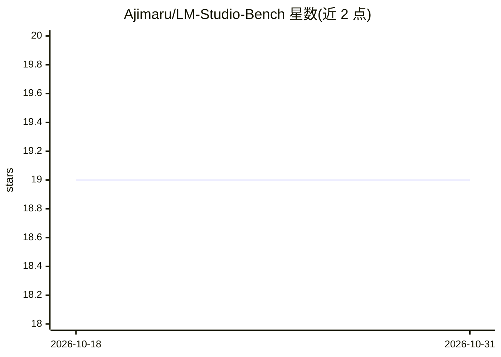

# Ajimaru/LM-Studio-Bench

⭐ 19 · Python · MIT · 推送 2026-10-27 · [GitHub](https://github.com/Ajimaru/LM-Studio-Bench) · [官网](https://ajimaru.github.io/LM-Studio-Bench/) · 个人维护

**自动对本地 LM Studio 全部模型做性能基准测试并生成报告**

面向 LM Studio 用户的自动化基准测试工具：自动发现本地已安装的模型与量化版本，逐一加载并以相同提示词测量 tokens-per-second、TTFT、VRAM 用量等指标，支持渐进式 GPU offload 尝试与 SQLite 结果缓存。提供 FastAPI Web 仪表盘（实时 WebSocket 输出、预设管理、结果浏览）与 Linux 系统托盘，可导出 JSON/CSV/PDF/HTML 报告，可选进行文本、推理、视觉、工具与代码执行的能力测试。主平台 Linux，macOS Apple Silicon 可用，Windows 未测试；需本机安装 LM Studio 或其 Headless 版及 lms CLI。推荐约 12GB VRAM 或 16GB+ 统一内存。

## 筛选速览

| 维度 | 判定 | 备注 |
|---|---|---|
| AI 角色 | `ai-ecosystem` | LLM/agent 周边工具 |
| 许可风险 | `permissive` | MIT |
| 部署形态 | `desktop` | 安装包/桌面程序 |
| 模型依赖 | — | README 未给出锁定关系 |
| 硬件要求 | `gpu-8g` | |
| 安装摩擦 | `low` | 无编译、无系统依赖或容器化 |
| 成熟度 | — | 结构信号不足 |

## 能力要点

- 自动发现并逐一测试本地所有 LM Studio 模型与量化版本
- FastAPI Web 仪表盘：实时流式输出、参数配置、预设管理与结果浏览
- 导出 JSON/CSV/PDF/HTML 报告，缓存数据可 <1s 再生成
- GPU 检测（NVIDIA/AMD/Intel）与温度、功耗、VRAM/GTT 实时监控

## 适用场景

- 批量比较本机已装模型与量化版本的生成速度
- 为选型导出含最佳实践建议的 PDF/HTML 基准报告
- 无人值守长跑测试并监控 GPU 温度/功耗上限

## 场景标签

`模型评测` · 领域:评测与运维

## 证据(README 行号)

> L5: Automatic benchmarking tool for all locally installed LM Studio models. Systematically tests different models and
> L52: - 🔌 **LM Studio REST API v1 Support**: Native integration with `/api/v1/*` endpoints
> L71: - 📈 **Statistical Evaluation**: Warmup + multiple measurements for accurate results

## 星数曲线

2026-10-18 19 → 2026-10-31 19（+0）

---
*卡片 v1 · prompt 1.4 · 生成 2026-10-29 · 置信度 mid · 依据 README sha `d931753a714e` · [字段定义](../../DATASET.md)*
