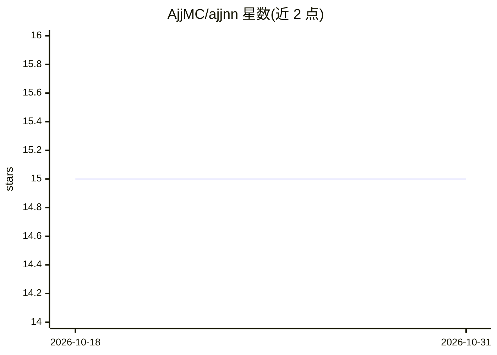

# AjjMC/ajjnn

⭐ 15 · mcfunction · NOASSERTION · 推送 2026-08-20 · [GitHub](https://github.com/AjjMC/ajjnn) · 个人维护

**在 Minecraft 数据包中部署神经网络做推理的地图制作库**

面向 Minecraft 地图制作者的神经网络部署数据包：以黑盒方式在游戏内运行动态推理，附带 Python 脚本 convert.py 将 torch.nn.Sequential 训练的 PyTorch 模型转换为 mcfunction 文件载入游戏。当前实现 Linear 层与 ReLU/HardSigmoid 激活函数，输入特征数与网络宽度不超过 784，深度无限制；模型参数保留三位小数以适配数据包浮点运算。附带基于 EMNIST 训练的手写字符分类演示模型与可绘制画布。

## 筛选速览

| 维度 | 判定 | 备注 |
|---|---|---|
| AI 角色 | `ai-ecosystem` | LLM/agent 周边工具 |
| 许可风险 | `none` | NOASSERTION |
| 部署形态 | `None` |  |
| 模型依赖 | — | README 未给出锁定关系 |
| 硬件要求 | — | 无带数字的原话,不猜 |
| 安装摩擦 | `low` | 无编译、无系统依赖或容器化 |
| 成熟度 | — | 结构信号不足 |

## 能力要点

- PyTorch 模型经 convert.py 转换为 mcfunction 在游戏内推理
- 支持 Linear 层与 ReLU/HardSigmoid，宽度上限 784、深度不限
- EMNIST 手写字符分类演示模型（数字 96% 精度等三个模型）
- 画布射线检测实时绘制并即时反馈推理结果

## 适用场景

- 地图制作者在自制地图中集成神经网络分类功能
- 用画布演示手写数字/字母识别
- 将自有 PyTorch Sequential 模型部署到 Minecraft 世界

## 场景标签

`推理引擎` · 领域:训练与推理

## 证据(README 行号)

> L15: This datapack allows mapmakers to deploy neural networks of arbitrary widths and depths in Minecraft. It functions 
> L45: The datapack is limited to neural networks trained in PyTorch using ``torch.nn.Sequential``. At the moment, the ``t

## 星数曲线

2026-10-18 15 → 2026-10-31 15（+0）

---
*卡片 v1 · prompt 1.4 · 生成 2026-10-31 · 置信度 high · 依据 README sha `c4d9456a1d22` · [字段定义](../../DATASET.md)*
