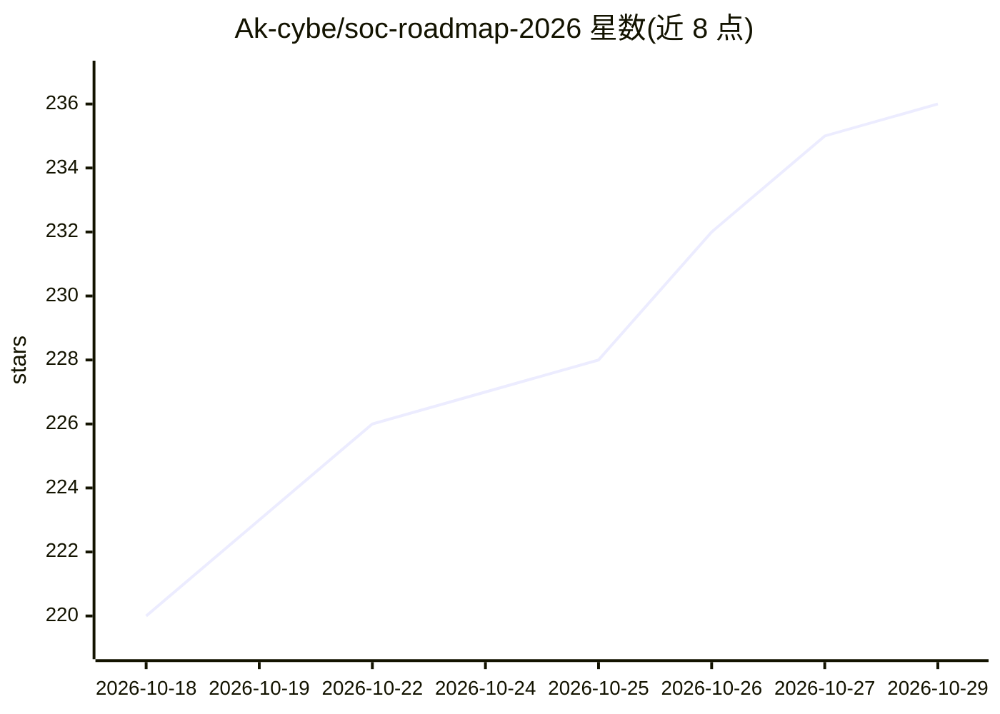

# Ak-cybe/soc-roadmap-2026

⭐ 236 · MIT · 推送 2026-08-28 · [GitHub](https://github.com/Ak-cybe/soc-roadmap-2026) · 个人维护

**SOC 安全分析师训练路线图：18 个动手项目与学习路径**

面向网络安全蓝队学习者的 SOC 分析师训练路线图仓库，提供 18 个（README 各处亦称 14/15 个）项目模板，覆盖 SIEM 监控、钓鱼分析、SOAR 编排、ML 威胁情报、AI 辅助威胁狩猎、后量子密码、AD 攻防、云取证与恶意软件逆向等，基于 LetsDefend、TryHackMe、Splunk、Wazuh、n8n、MISP 等免费平台与工具。提供 4 条学习路径（10-40 周）、核心文档约 25 万词，模板含逐日执行计划、简历要点与面试答案。内容为 Markdown 文档与项目模板，不含可运行软件。

## 筛选速览

| 维度 | 判定 | 备注 |
|---|---|---|
| AI 角色 | `ai-knowledge` | 知识聚合/清单类 |
| 许可风险 | `permissive` | MIT |
| 部署形态 | `None` |  |
| 模型依赖 | — | README 未给出锁定关系 |
| 硬件要求 | — | 无带数字的原话,不猜 |
| 安装摩擦 | `low` | 无编译、无系统依赖或容器化 |
| 成熟度 | — | 结构信号不足 |

## 能力要点

- 18 个项目模板分 6 阶段：基础、自动化、AI 新技术、攻防精通、AI 安全自动化
- 4 条学习路径对应 Tier-1 到安全架构师等目标岗位（10-40 周）
- 核心文档含快速入门指南、路线图、集成指南（250,000+ 词）
- AI 安全自动化项目基于 n8n 工作流（防火墙审计、事件响应管道、恶意软件分析）

## 适用场景

- 按路线图从零训练成为 SOC 分析师
- 搭建 SOAR 自动化与 ML 威胁情报项目作品集
- 准备安全岗位的简历要点与 STAR 面试回答

## 场景标签

`网络安全` `教程课程` · 领域:学习与行业

## 证据(README 行号)

> L60: |🚀 2026-Automation-First-Roadmap.md|Future-state vision (AI, SOAR, cloud, security leadership)|40 min|

## 星数曲线

2026-10-18 220 → 2026-10-29 236（+16）

---
*卡片 v1 · prompt 1.4 · 生成 2026-10-22 · 置信度 high · 依据 README sha `e76f92036d49` · [字段定义](../../DATASET.md)*
