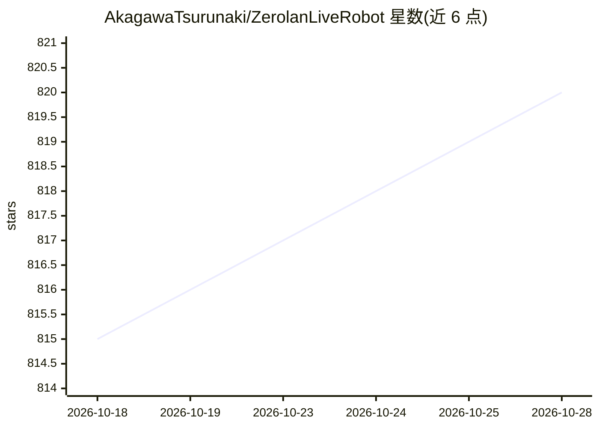

# AkagawaTsurunaki/ZerolanLiveRobot

⭐ 821 · Python · MIT · 推送 2026-04-14 · [GitHub](https://github.com/AkagawaTsurunaki/ZerolanLiveRobot) · [官网](https://github.com/AkagawaTsurunaki/ZerolanLiveRobot) · 个人维护 · 中文 README

**开源 AI VTuber：直播、聊天与 Minecraft 游玩的直播机器人**

多功能的直播机器人（AI VTuber），面向希望拥有 AI 虚拟形象直播、聊天、打游戏的个人用户。集 LLM 对话、ASR 语音识别、带情感的 TTS、OCR 与图像内容理解于一体，可读取 Bilibili/YouTube/Twitch 弹幕并回复，操纵 Minecraft 角色，支持 Live2D 形象控制与 OBS 字幕。AI 推理由配套 ZerolanCore 提供 Web API，或经统一模型管线接入第三方 API，须至少配置 LLM/ASR/TTS 三类模型。通过 conda 环境与 pip 安装依赖，运行 python main.py 启动，配置经 WebUI 或 YAML 完成。

## 筛选速览

| 维度 | 判定 | 备注 |
|---|---|---|
| AI 角色 | `ai-native` | 本体是模型或模型工具 |
| 许可风险 | `permissive` | MIT |
| 部署形态 | `library` | 以包/库形式分发 |
| 模型依赖 | — | README 未给出锁定关系 |
| 硬件要求 | — | 无带数字的原话,不猜 |
| 安装摩擦 | `low` | 无编译、无系统依赖或容器化 |
| 成熟度 | — | 结构信号不足 |

## 能力要点

- LLM 对话 + ASR/TTS + OCR/CV 屏幕理解的多模态集成
- 连接 Bilibili、YouTube（实验）、Twitch（实验）弹幕并回复
- 语音控制的 Minecraft 智能体与 Live2D 形象展示（嘴型同步）
- 基于 TypedEventEmitter 的事件驱动机器人开发框架与 HTTP 管线扩展

## 适用场景

- 让 AI 虚拟形象陪我直播并回复弹幕和语音
- 语音对话并控制 Minecraft 中的游戏角色
- 通过事件框架扩展自定义机器人行为

## 场景标签

`聊天机器人` `语音 Agent` `语音识别` `语音合成` · 领域:对话与助手

## 证据(README 行号)

> L5: 你或许已经听说过著名的 Neurosama，或者是来自中国的木几萌。你是否也想要拥有一个自己的 AI 虚拟形象陪你直播、聊天、打游戏？开源的 Zerolan Live Robot 正致力于实现您的梦想！而这仅仅需要一张消费级显卡！
> L7: Zerolan Live Robot 是一款多功能的直播机器人（AI VTuber），它可以听懂你所说的话，也可以自动在直播间中读取弹幕，观察电脑屏幕的指定窗口，理解其画面内容和文字信息，操纵 Minecraft 中的游戏角色，做出
> L15: - [x] 💭 基于大语言模型的自然语言对话，上下文理解和人机聊天

## 星数曲线

2026-10-18 815 → 2026-10-28 820（+5）

---
*卡片 v1 · prompt 1.4 · 生成 2026-10-21 · 置信度 high · 依据 README sha `43bcb60ad9ef` · [字段定义](../../DATASET.md)*
