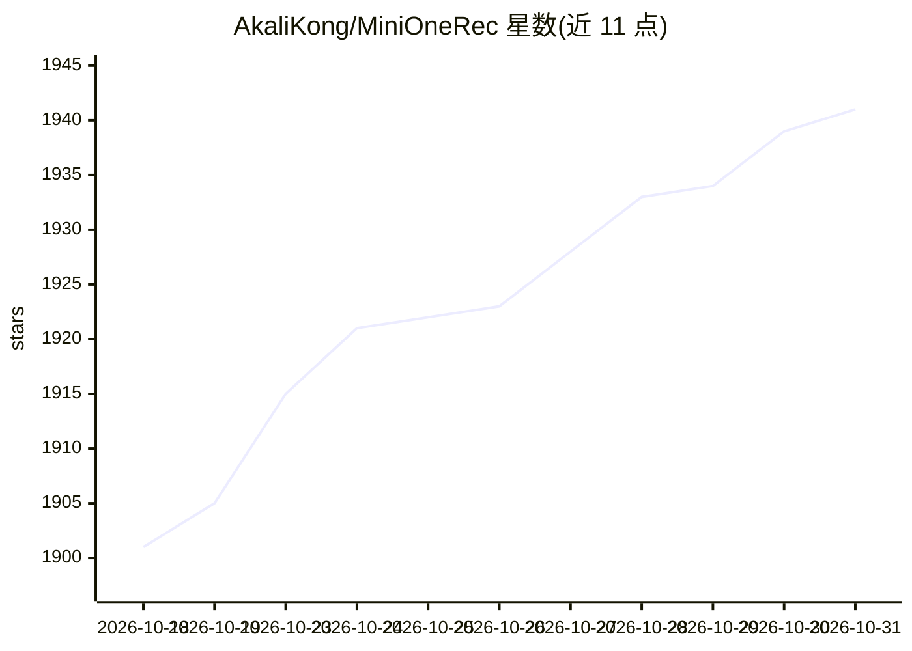

# AkaliKong/MiniOneRec

⭐ 1,941 · Python · Apache-2.0 · 推送 2026-10-19 · [GitHub](https://github.com/AkaliKong/MiniOneRec) · 个人维护

**开源生成式推荐复现框架：SID 构建+ SFT + 推荐向 RL 全流程**

对 OneRec 思路的开源最小复现，提供端到端工作流：将商品标题与描述经冻结文本编码器嵌入后用 RQ-VAE / RQ-Kmeans（含约束版、+版、FLASH SimHash、PRQ-KMeans 等）量化为 SID 语义 token；在此基础上对 LLM 做 SFT（可与语言对齐任务共同训练，支持冻结 LLM 只训新增 SID 词表嵌入），再以 GRPO 做推荐向强化学习，配合约束束搜索保证候选有效。面向生成式推荐研究者，附 Amazon18/23 预处理脚本与一键离线 Top-K 评测；复现需 4–8 张 A100/H100 80GB。已知限制：Instruct 模型约束解码失效问题仍在排查（公告 2026-01-04），建议改用 base 模型。

## 筛选速览

| 维度 | 判定 | 备注 |
|---|---|---|
| AI 角色 | `ai-native` | 本体是模型或模型工具 |
| 许可风险 | `permissive` | Apache-2.0 |
| 部署形态 | `library` | 以包/库形式分发 |
| 模型依赖 | — | README 未给出锁定关系 |
| 硬件要求 | — | 无带数字的原话,不猜 |
| 安装摩擦 | `low` | 无编译、无系统依赖或容器化 |
| 成熟度 | — | 结构信号不足 |

## 能力要点

- SID 构建提供 RQ-VAE、RQ-Kmeans/约束版/+、FLASH SimHash 等多种方法
- GRPO 推荐向 RL + 约束束搜索 + 组内奖励归一化与 KL 约束
- SFT 阶段与语言-SID 对齐任务共同训练，可冻结 LLM 仅训 SID 词嵌入
- 提供预训练 Industrial/Office SIDs 与一键 HR@K / NDCG@K 离线评测脚本

## 适用场景

- 复现或研究 OneRec 式生成式推荐全流程
- 在自己的商品数据上训练语义 ID 生成式推荐模型
- 研究 SID 构建方法（RQ-VAE/RQ-Kmeans/FLASH）对推荐效果的影响

## 场景标签

`推荐系统` `强化学习` `微调` · 领域:学习与行业

## 证据(README 行号)

> L11: **MiniOneRec** is the first fully open-source **generative recommendation** framework, which provides an end-to-end
> L45: - **Recommendation-Oriented RL: After SFT, MiniOneRec is further polished with a recommendation-oriented RL phase b
> L128: - GPUs: <e.g., 4–8 × A100/H100 80 GB or comparable>

## 星数曲线

2026-10-18 1,901 → 2026-10-31 1,941（+40）

---
*卡片 v1 · prompt 1.4 · 生成 2026-10-21 · 置信度 high · 依据 README sha `dc95b4fec3be` · [字段定义](../../DATASET.md)*
