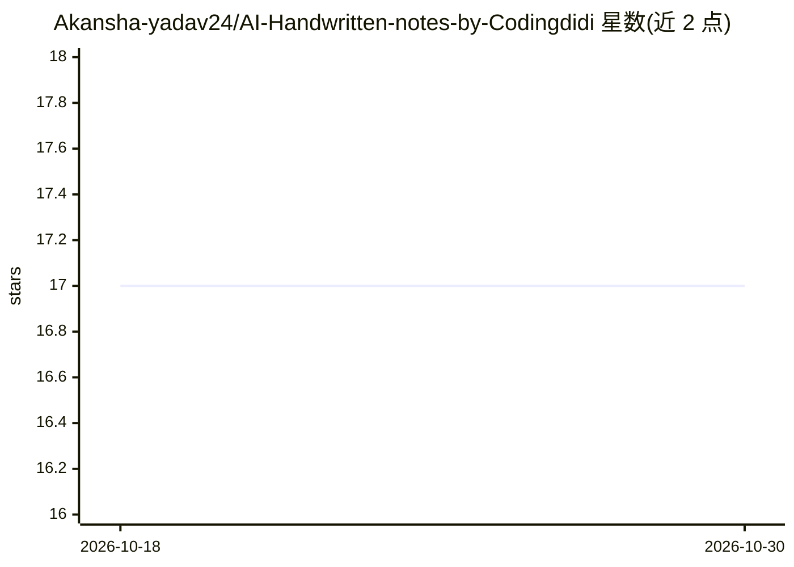

# Akansha-yadav24/AI-Handwritten-notes-by-Codingdidi

⭐ 17 · 推送 2026-07-15 · [GitHub](https://github.com/Akansha-yadav24/AI-Handwritten-notes-by-Codingdidi) · 个人维护

**面向学生与初学者的 AI 学习手写笔记（PDF）合集**

个人维护的手写笔记仓库，涵盖 Tokenization、LLM 工作原理、Embedding、Andrej Karpathy 视频内容总结、CNN/RNN 等主题及学习路线图，以 PDF 形式提供。内容按主题顺序组织，定位于考试复习、面试准备与初学者入门，使用方式为下载 PDF 后按顺序阅读并练习。仓库不包含可运行代码或安装步骤。

## 筛选速览

| 维度 | 判定 | 备注 |
|---|---|---|
| AI 角色 | `ai-knowledge` | 知识聚合/清单类 |
| 许可风险 | `none` | — |
| 部署形态 | `None` |  |
| 模型依赖 | — | README 未给出锁定关系 |
| 硬件要求 | — | 无带数字的原话,不猜 |
| 安装摩擦 | `low` | 无编译、无系统依赖或容器化 |
| 成熟度 | — | 结构信号不足 |

## 能力要点

- 涵盖 Tokenization、LLM 原理、Embedding 等 AI 基础主题的手写 PDF 笔记
- 包含 Andrej Karpathy 视频内容总结与学习路线图
- 面向考试与面试的快速复习材料

## 适用场景

- 初学者按顺序学习 AI 基础概念
- 考试或面试前快速复习
- 偏好手写笔记的学习者替代冗长教材

## 场景标签

`教程课程` · 领域:学习与行业

## 证据(README 行号)

> L5: This repository contains my personally curated handwritten notes designed to help students and beginners build a str
> L9: * Well-structured handwritten notes

## 星数曲线

2026-10-18 17 → 2026-10-30 17（+0）

---
*卡片 v1 · prompt 1.4 · 生成 2026-10-30 · 置信度 mid · 依据 README sha `6fc82e065dfb` · [字段定义](../../DATASET.md)*
