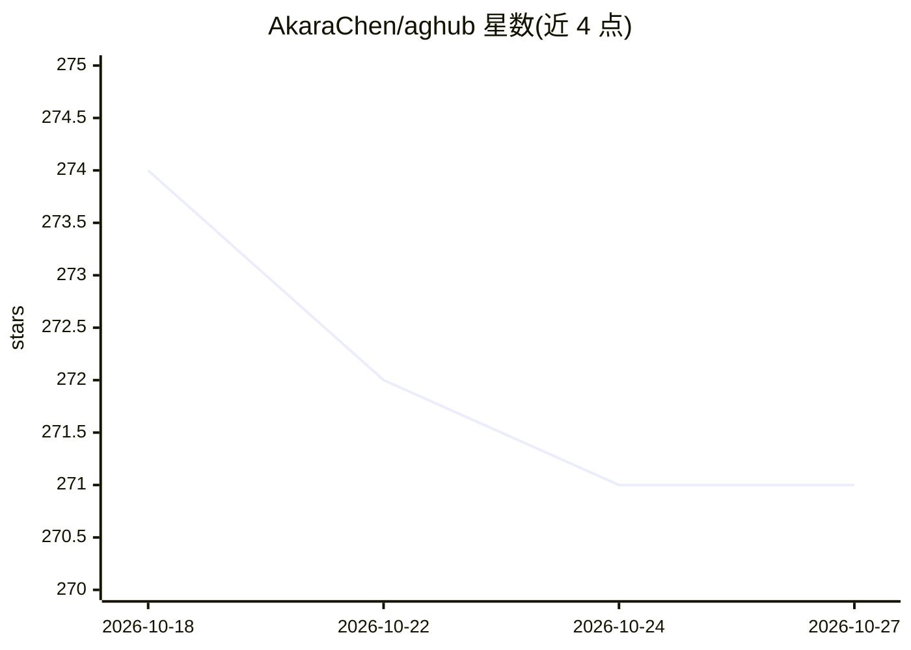

# AkaraChen/aghub

⭐ 271 · TypeScript · MIT · 推送 2026-10-20 · [GitHub](https://github.com/AkaraChen/aghub) · [官网](https://aghub.akr.moe) · 个人维护 · 中文 README

**AI 编程 agent 的统一配置管理桌面应用（22+ 种）**

基于 Tauri 构建的桌面工具，面向同时使用多个 AI coding agent 的开发者：统一管理 22+ 种 agent 的 MCP 服务器配置（支持 Stdio/SSE/StreamableHttp），一次配置分发到所有 agent；支持导入与跨 agent 共享 .skill 技能包（含 SHA-256 校验）、安装 Claude Code 插件（官方仓库/第三方 Git/本地路径，全局或项目作用域）、为各 agent 独立配置模型与自定义推理端点（Anthropic Messages / OpenAI Chat Completions / OpenAI Responses 格式），API 密钥存于系统原生钥匙串。macOS 提供 Homebrew 安装，Windows 为实验性。

## 筛选速览

| 维度 | 判定 | 备注 |
|---|---|---|
| AI 角色 | `ai-ecosystem` | LLM/agent 周边工具 |
| 许可风险 | `permissive` | MIT |
| 部署形态 | `desktop` | 安装包/桌面程序 |
| 模型依赖 | — | README 未给出锁定关系 |
| 硬件要求 | — | 无带数字的原话,不猜 |
| 安装摩擦 | `low` | 无编译、无系统依赖或容器化 |
| 成熟度 | `idea` | |

## 能力要点

- 一次配置 MCP 分发到 22+ 种 agent，支持 Stdio/SSE/StreamableHttp
- 跨 agent 共享 .skill 技能包，含 SHA-256 内容校验与来源追踪
- 插件全生命周期管理（安装/更新/启停/移除），支持全局或项目作用域
- 各 agent 独立选择模型，可指向自定义推理端点，密钥存 OS 原生钥匙串

## 适用场景

- 同时在多个 AI coding agent 间同步 MCP 服务器配置
- 统一安装和分享可跨 agent 复用的技能与插件
- 为不同 agent 分别指定模型供应商或自建推理端点

## 场景标签

 · 领域:开发者工具/AI agent 基础设施

## 证据(README 行号)

> L5: **One hub for every AI coding agent.**
> L48: - Configure once, deploy to any of 22+ supported agents

## 星数曲线

2026-10-18 274 → 2026-10-27 271（-3）

---
*卡片 v1 · prompt 1.4 · 生成 2026-10-22 · 置信度 high · 依据 README sha `fbdb3694fe6e` · [字段定义](../../DATASET.md)*
