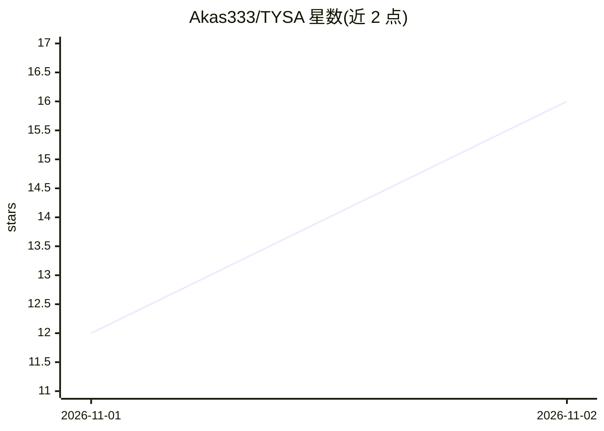

# Akas333/TYSA

⭐ 16 · TypeScript · AGPL-3.0 · 推送 2026-11-01 · [GitHub](https://github.com/Akas333/TYSA) · [官网](https://akas333.github.io/TYSA/) · 个人维护

**自适应学习桌面应用：测出你懂到哪，从那里开始教**

Electron 桌面应用，构建于 Meta 的 Muse 模型之上。教学流程分四步：先通过探测题、置信度与学习者自述理由测量已有理解，再生成可视化依赖图课程计划，随后按步教学并随回答动态调整，另有基于知识图谱的练习模式。学习内容以声明与推理链形式存为本地知识图谱，后续课程复用；支持导入自有 PDF/图片/笔记。需自备 Meta API key，或用 Ollama 跑 Llama 实现完全离线；数据本地存储，可用口令加密导出。

## 筛选速览

| 维度 | 判定 | 备注 |
|---|---|---|
| AI 角色 | `ai-native` | 本体是模型或模型工具 |
| 许可风险 | `viral` | AGPL-3.0 |
| 部署形态 | `desktop` | 安装包/桌面程序 |
| 模型依赖 | local-ok | 支持本地模型 |
| 硬件要求 | — | 无带数字的原话,不猜 |
| 安装摩擦 | `low` | 无编译、无系统依赖或容器化 |
| 成熟度 | — | 结构信号不足 |

## 能力要点

- 测量→规划→教学→练习的自适应学习回路，计划随回答动态调整
- 学习内容存为声明与推理链构成的知识图谱，跨课程复用
- 支持 Ollama 运行 Llama 开放权重模型，完全离线无需 key
- 数据本地明文存储，口令加密导出/导入，系统提示词可在设置中查看编辑

## 适用场景

- 我想让 AI 先摸清我已掌握的程度，再从断点处教我新知识
- 用自己的 PDF、图片和笔记生成按章教学的课程
- 用 Ollama 本地模型离线学习，不上传数据、不用订阅

## 场景标签

`知识图谱` · 领域:知识与检索

## 证据(README 行号)

> L18: Most AI learning tools just explain. TYSA is an engineered learning harness: it first measures what *you* already u
> L20: Built on Meta's Muse models for the **Meta Global AI Developer Hackathon** (Indie Developer track).
> L72: Each Meta model does a separate job in the teaching loop. All of them go through one Meta Model API key.

## 星数曲线

2026-11-01 12 → 2026-11-02 16（+4）

---
*卡片 v1 · prompt 1.4 · 生成 2026-11-01 · 置信度 high · 依据 README sha `260de1951e10` · [字段定义](../../DATASET.md)*
