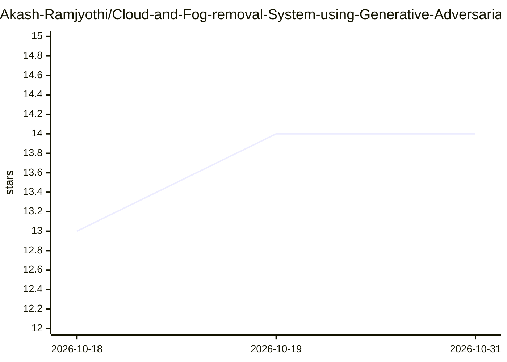

# Akash-Ramjyothi/Cloud-and-Fog-removal-System-using-Generative-Adversarial-Networks-Satellite-Image-Processing

⭐ 14 · Python · 推送 2026-05-29 · [GitHub](https://github.com/Akash-Ramjyothi/Cloud-and-Fog-removal-System-using-Generative-Adversarial-Networks-Satellite-Image-Processing) · 个人维护

**用 GAN 去除卫星影像中云雾的图像处理系统**

基于生成对抗网络的卫星图像去云去雾系统：输入含云雾的卫星影像，输出预测的无云地表图像。项目对 ISRO 既有的计算机视觉模型进行优化，作者在 ISRO NRSC（海得拉巴）实习期间通过 Bhuvan 平台配置与测试，报告准确率 84%。以 Python 3.7 + PyTorch 1.7.1 环境运行，依赖较旧版本 API，在新版 Python/PyTorch 上可能需要修改。附研究论文与实习报告链接。

## 筛选速览

| 维度 | 判定 | 备注 |
|---|---|---|
| AI 角色 | `ai-native` | 本体是模型或模型工具 |
| 许可风险 | `none` | — |
| 部署形态 | `library` | 以包/库形式分发 |
| 模型依赖 | — | README 未给出锁定关系 |
| 硬件要求 | — | 无带数字的原话,不猜 |
| 安装摩擦 | `low` | 无编译、无系统依赖或容器化 |
| 成熟度 | `idea` | |

## 能力要点

- GAN 生成无云地表预测图像
- 优化 ISRO 既有视觉模型并在 Bhuvan 平台测试
- 报告 84% 准确率
- 提供论文与实习报告链接

## 适用场景

- 处理被云雾遮挡的卫星遥感影像
- 遥感地表重建相关的实验与学习

## 场景标签

`图像视频处理` · 领域:感知与多模态

## 证据(README 行号)

> L4: Optimized ISRO's pre-existing computer vision models to remove clouds and fog from satellite images. Achieved 84% ac
> L30: * Python 3.7

## 星数曲线

2026-10-18 13 → 2026-10-31 14（+1）

---
*卡片 v1 · prompt 1.4 · 生成 2026-10-31 · 置信度 mid · 依据 README sha `cf562b5465f4` · [字段定义](../../DATASET.md)*
