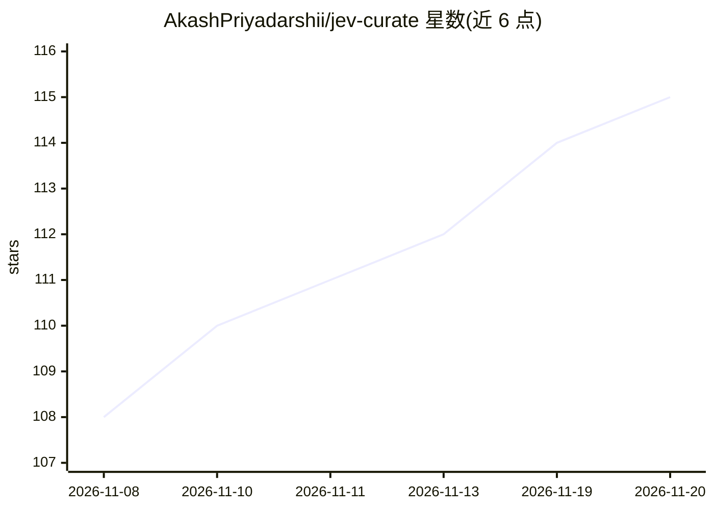

# AkashPriyadarshii/jev-curate

⭐ 115 · Rust · MIT · 推送 2026-11-11 · [GitHub](https://github.com/AkashPriyadarshii/jev-curate) · [官网](https://jev-curate.vercel.app) · 个人维护

**开发者用的高吞吐合成/预训练数据集筛选 CLI 与 Python 库**

基于 Rust 流式核心的数据清洗工具：读取 Parquet/JSONL 数据集，通过 TypeSafe AI 的 Jev 模型按预设评分规则（reasoning-math、anti-sycophancy、code-correctness）逐行判定，输出 clean/rejected 两组结果，全程不改写原文本。判定采用 Noul 校准概率、Score 序数评分、Choice 分类三种类型；单行一次 HTTP 请求完成全部规则评估，实测 23.9 行/秒（单节点），1,500+ 行/秒为集群目标而非实测。提供 cargo/pip 安装与 PyO3 Python 绑定，支持 dry-run 免 API key 的本地预过滤。作者自述 v0.2.0 为实验性 Beta。

## 筛选速览

| 维度 | 判定 | 备注 |
|---|---|---|
| AI 角色 | `ai-ecosystem` | LLM/agent 周边工具 |
| 许可风险 | `permissive` | MIT |
| 部署形态 | `library` | 以包/库形式分发 |
| 模型依赖 | — | README 未给出锁定关系 |
| 硬件要求 | — | 无带数字的原话,不猜 |
| 安装摩擦 | `high` | 编译与系统依赖俱全 |
| 成熟度 | `idea` | |

## 能力要点

- Parquet/JSONL 流式输入，输出 clean/rejected 分类文件
- 三种预设评分规则：reasoning-math / anti-sycophancy / code-correctness
- Noul/Score/Choice 类型化判定，单行一次 HTTP 请求
- dry-run 模式仅做本地预过滤，无需 API key；CI 测试用进程内 mock 服务器

## 适用场景

- 清洗千万到十亿行的合成推理数据与指令微调对
- 过滤数据集中的循环推理、谄媚话术与不完整代码块
- 预训练语料入库前的批量质量筛选

## 场景标签

 · 领域:数据工程/LLM 数据集策展

## 证据(README 行号)

> L34: `jev-curate` solves this by piping Parquet/JSONL through **TypeSafe AI's Jev model** (`jev-latest`, pin with `JEV_M
> L35: * **Single-round-trip rubrics per row:** Evaluates all rubric questions concurrently in one HTTP request per row vi

## 星数曲线

2026-11-08 108 → 2026-11-20 115（+7）

---
*卡片 v1 · prompt 1.4 · 生成 2026-11-17 · 置信度 high · 依据 README sha `69532b8edacd` · [字段定义](../../DATASET.md)*
