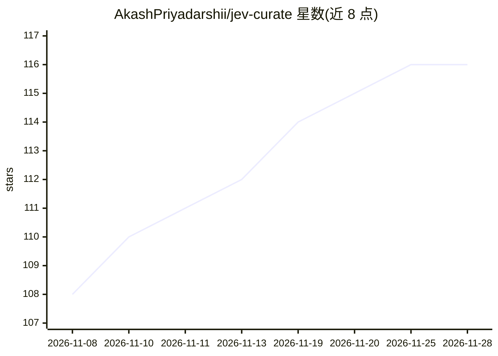

# AkashPriyadarshii/jev-curate

⭐ 116 · Rust · MIT · 推送 2026-11-27 · [GitHub](https://github.com/AkashPriyadarshii/jev-curate) · [官网](https://jev-curate.vercel.app) · 个人维护

**面向微调数据准备的 Parquet/JSONL 数据集筛选 CLI**

Rust/Python 双端 CLI 与库，流式读取 Parquet/JSONL 数据集，按 YAML 预设（reasoning-math、anti-sycophancy、code-correctness 或自定义）调用 TypeSafe 的 Jev 模型 API 对每行做 Noul/Score/Choice 判定，输出 clean/rejected/errors 三路结果，保留原始文本不改写。带本地 secret_scan 与 sanity 预过滤的 --dry-run 模式，无需 API key；支持 --resume、有界流式背压、限速与自定义 endpoint 的离线 mock 测试。Python 绑定经 maturin 构建提供。

## 筛选速览

| 维度 | 判定 | 备注 |
|---|---|---|
| AI 角色 | `ai-ecosystem` | LLM/agent 周边工具 |
| 许可风险 | `permissive` | MIT |
| 部署形态 | `library` | 以包/库形式分发 |
| 模型依赖 | — | README 未给出锁定关系 |
| 硬件要求 | — | 无带数字的原话,不猜 |
| 安装摩擦 | `medium` | 含编译或系统依赖之一 |
| 成熟度 | — | 结构信号不足 |

## 能力要点

- 每行单次 HTTP 请求内并发执行全部 rubric 判定（speculative fan-out）
- clean/rejected/errors 三路输出，rejected 附拒绝原因
- --dry-run 本地预过滤（secret_scan + sanity）零 API 调用
- cargo 与 pip 双通道安装，支持 Parquet 输出并保留 Arrow schema

## 适用场景

- 微调前从大规模 Parquet/JSONL 训练集中筛除低质量行
- 按自定义 YAML rubric 批量给合成数据打分分类
- 清洗掉含敏感信息或不完整代码的数据行

## 场景标签

`微调` · 领域:训练与推理

## 证据(README 行号)

> L67: - **Single-round-trip rubrics per row**: Evaluates all rubric questions concurrently in one HTTP request per row vi
> L129: |`--model`|`jev-latest`|Jev model (or `JEV_MODEL` env; pin `jev-1.13.0` for repro).|
> L166: - **Not a local vector DB**: No embeddings, no vector indices, zero PyTorch/CUDA runtime requirements.

## 星数曲线

2026-11-08 108 → 2026-11-28 116（+8）

---
*卡片 v1 · prompt 1.4 · 生成 2026-11-28 · 置信度 mid · 依据 README sha `dae555806d33` · [字段定义](../../DATASET.md)*
