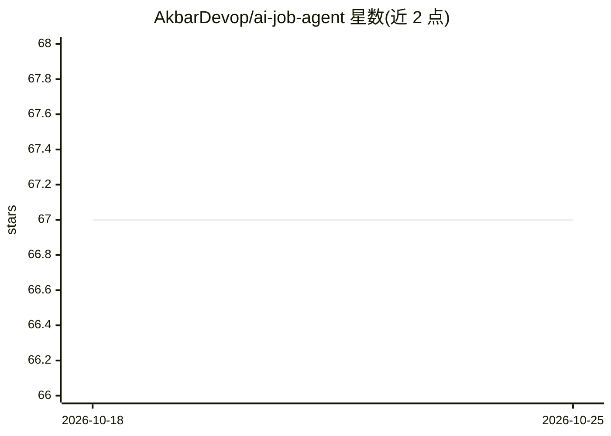

# AkbarDevop/ai-job-agent

⭐ 67 · JavaScript · MIT · 推送 2026-04-26 · [GitHub](https://github.com/AkbarDevop/ai-job-agent) · 个人维护

**运行在 Claude Code 内的求职申请自动化 agent 技能包**

面向求职者的 agent 技能集合，安装到 Claude Code 后以对话方式驱动：包含 13 个技能（1 个编排器 + 12 个动词技能），封装 Node/Python 脚本，覆盖 LinkedIn Easy Apply、Greenhouse/Lever/Jobvite/Ashby 五个 ATS 平台的自动填表申请、LinkedIn 人脉拓展、冷邮件、Outlook 邮件分诊、JD 评分与追踪。作者自述用它提交 228+ 份真实申请，支持双简历路由、CAPTCHA 阻塞如实记录、多会话记忆延续。需 Claude Code、Git、Node.js 18+，可选 msmtp 发冷邮件；也可脱离 Claude Code 作为独立 CLI 脚本使用。

## 筛选速览

| 维度 | 判定 | 备注 |
|---|---|---|
| AI 角色 | `ai-native` | 本体是模型或模型工具 |
| 许可风险 | `permissive` | MIT |
| 部署形态 | `None` |  |
| 模型依赖 | locked-api |  |
| 硬件要求 | — | 无带数字的原话,不猜 |
| 安装摩擦 | `low` | 无编译、无系统依赖或容器化 |
| 成熟度 | — | 结构信号不足 |

## 能力要点

- 5 个 ATS 平台（LinkedIn/Greenhouse/Lever/Jobvite/Ashby）配置驱动的自动填表申请
- 13 个技能：编排器 + 申请/拓展/跟进/看板/追踪/分诊等动词技能
- 统一终端：Claude Code 对话 + tmux 实时 TUI 看板，约 200ms 内同步
- 多会话记忆延续，无需重复交代背景；CAPTCHA 命中如实记为 blocked

## 适用场景

- 我想让 agent 批量代填多个招聘平台的申请表并追踪状态
- 我想让 agent 做 LinkedIn 人脉拓展、冷邮件和自动跟进
- 我在 Claude Code 里用对话方式管理整个求职流程和漏斗看板

## 场景标签

`浏览器自动化` `工作流自动化` · 领域:效率与自动化

## 证据(README 行号)

> L35: **A career coach you talk to inside Claude Code.** Not a CLI. Not a wizard. A persona.
> L46: Under the hood, there are **13 skills** (one orchestrator + 12 verbs) that wrap Node and Python scripts for LinkedI

## 星数曲线

2026-10-18 67 → 2026-10-25 67（+0）

---
*卡片 v1 · prompt 1.4 · 生成 2026-10-24 · 置信度 high · 依据 README sha `b1eee0229952` · [字段定义](../../DATASET.md)*
