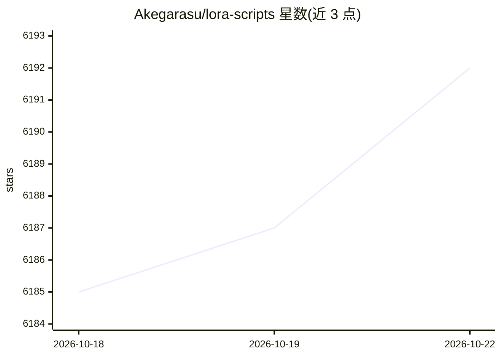

# Akegarasu/lora-scripts

⭐ 6,194 · Python · AGPL-3.0 · 推送 2026-09-28 · [GitHub](https://github.com/Akegarasu/lora-scripts) · 个人维护 · 中文 README

**面向 Stable Diffusion 的 LoRA/Dreambooth 训练 GUI 与脚本集**

基于 kohya-ss/sd-scripts 训练器封装的 Stable Diffusion LoRA 与 Dreambooth 训练工具：提供 WebUI 形式的训练工作室（集成 TensorBoard、WD 1.4 Tagger、Tag Editor），也保留手工编辑脚本的训练方式。安装脚本自动创建 venv 并安装依赖，中国大陆提供专用安装脚本，通过 run_gui 脚本启动并在浏览器访问 127.0.0.1:28000。依赖 Python 3.10 与 Git，需以 git clone --recurse-submodules 获取含子模块的源码。

## 筛选速览

| 维度 | 判定 | 备注 |
|---|---|---|
| AI 角色 | `ai-ecosystem` | LLM/agent 周边工具 |
| 许可风险 | `viral` | AGPL-3.0 |
| 部署形态 | `None` |  |
| 模型依赖 | — | README 未给出锁定关系 |
| 硬件要求 | — | 无带数字的原话,不猜 |
| 安装摩擦 | `low` | 无编译、无系统依赖或容器化 |
| 成熟度 | — | 结构信号不足 |

## 能力要点

- WebUI 训练工作室，集成 TensorBoard / WD 1.4 Tagger / Tag Editor
- Windows/Linux 安装脚本自动创建 venv 并安装依赖，中国大陆提供专用脚本
- 保留手工编辑 train.ps1/train.sh 的传统训练方式
- 支持 host/port/listen 等服务参数与界面本地化设置

## 适用场景

- 通过 GUI 一站式完成 Stable Diffusion LoRA / Dreambooth 训练
- 在训练集中用 Tag Editor 与 WD 1.4 Tagger 处理图片标注
- 编辑脚本自定义训练参数进行模型微调

## 场景标签

`微调` · 领域:训练与推理

## 证据(README 行号)

> L28: LoRA & Dreambooth training GUI & scripts preset & one key training environment for kohya-ss/sd-scripts
> L32: The **REAL** Stable Diffusion Training Studio. Everything in one WebUI.

## 星数曲线

2026-10-18 6,185 → 2026-10-22 6,192（+7）

---
*卡片 v1 · prompt 1.4 · 生成 2026-10-20 · 置信度 high · 依据 README sha `415f2135fc76` · [字段定义](../../DATASET.md)*
