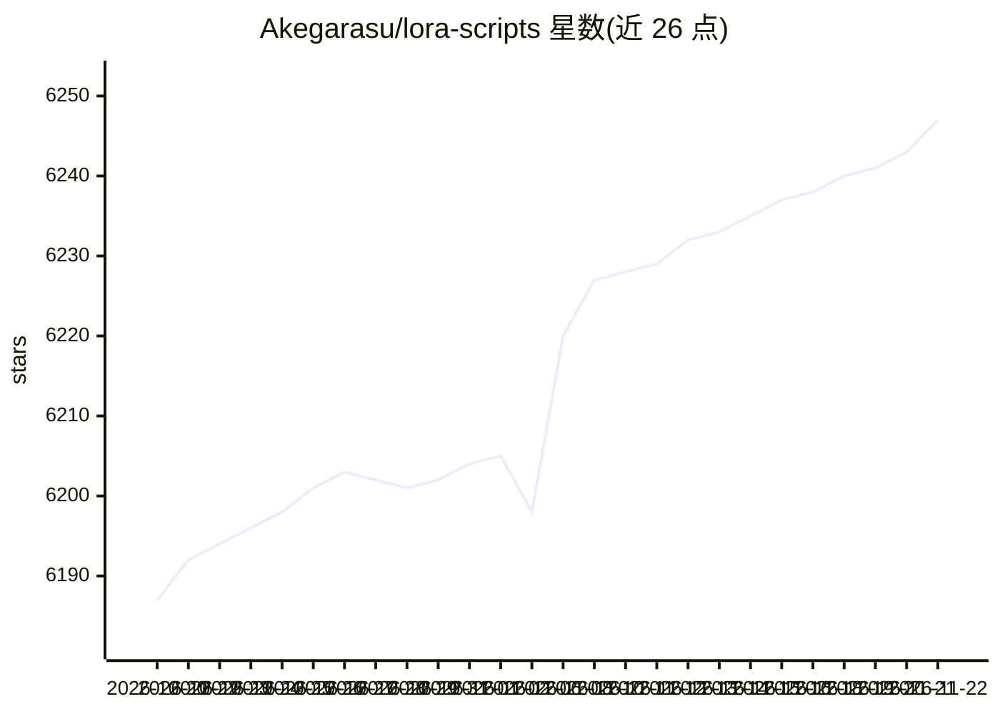

# Akegarasu/lora-scripts

⭐ 6,247 · Python · AGPL-3.0 · 推送 2026-11-03 · [GitHub](https://github.com/Akegarasu/lora-scripts) · 个人维护 · 中文 README

**本地 Stable Diffusion LoRA/ DreamBooth 训练与打标工作台**

基于 kohya-ss/sd-scripts 构建的本地训练与数据集工作台，v2 界面把训练配置、打标生成、标签编辑、任务日志与指标整合为一个 GUI 应用。支持 SD、SDXL、SD3、FLUX.1、Chroma、Lumina、混元图像等模型的 LoRA 训练；Caption 工作区用 WD/CL tagger、BLIP/GIT 与对话式 VLM 生成标签或描述；内置 MCP 服务器使 agent 可提交训练任务、检查数据集并读取日志与输出图像。提供 Windows NVIDIA 便携包、源码安装与 Docker 部署。

## 筛选速览

| 维度 | 判定 | 备注 |
|---|---|---|
| AI 角色 | `ai-native` | 本体是模型或模型工具 |
| 许可风险 | `viral` | AGPL-3.0 |
| 部署形态 | `self-host` | docker 或自建部署 |
| 模型依赖 | — | README 未给出锁定关系 |
| 硬件要求 | — | 无带数字的原话,不猜 |
| 安装摩擦 | `low` | 无编译、无系统依赖或容器化 |
| 成熟度 | — | 结构信号不足 |

## 能力要点

- 训练配置、打标、标签编辑、日志与指标一体化 GUI
- 内置 MCP 服务器，agent 可共享训练队列并检查数据集、提交实验
- Caption 工作区支持 WD/CL tagger、BLIP/GIT 与聊天 VLM 生成标签
- 提供 Windows 便携包、源码安装与 Docker 三种部署方式

## 适用场景

- 为 Stable Diffusion/FLUX 等模型训练 LoRA 微调权重
- 批量扫描数据集并生成标签或自然语言描述
- 通过 MCP 让本地 agent 代管训练任务与监控指标
- 国内网络环境下经镜像安装与下载前端

## 场景标签

`微调` · 领域:训练与推理

## 证据(README 行号)

> L3: LoRA-scripts (SD-Trainer) is a local training and dataset workspace built on kohya-ss/sd-scripts. The v2 interface b
> L11: The current catalog includes SD, SDXL, SD3, FLUX.1, Chroma, Lumina, HunyuanImage 2.1, Anima and MOSS-Image Base / S
> L27: Starting the GUI also enables the built-in MCP server by default. Connect a local MCP client using Streamable HTTP 

## 星数曲线

2026-10-20 6,187 → 2026-11-22 6,247（+60）

---
*卡片 v1 · prompt 1.4 · 生成 2026-11-22 · 置信度 mid · 依据 README sha `33dd716d4e83` · [字段定义](../../DATASET.md)*
