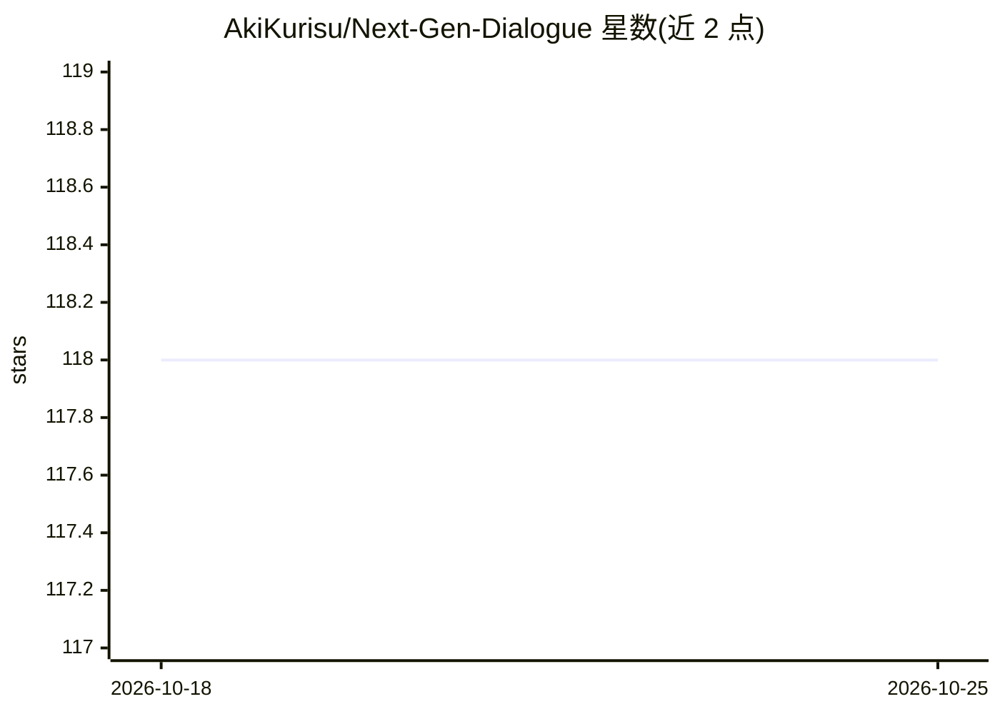

# AkiKurisu/Next-Gen-Dialogue

⭐ 118 · C# · 推送 2026-03-28 · [GitHub](https://github.com/AkiKurisu/Next-Gen-Dialogue) · [官网](https://deepwiki.com/AkiKurisu/Next-Gen-Dialogue/) · 个人维护 · 中文 README

**面向 Unity 的 AI 辅助对话系统可视化设计器**

Unity 对话插件，提供节点式可视化编辑器构建对话树（Dialogue/Piece/Option 三类节点与 Module 扩展系统），支持自定义行为（集成 Ceres.Flow）、本地化、Google 翻译与运行时调试模拟器。AI 部分：设计期用 LLM 预生成对话内容的 AI Bake、让 AI 充当编剧生成对话树的 Novel 模式，以及通过 VITS 本地服务器生成/烘焙语音。要求 Unity 2022.3 LTS 或更新版本，经 Package Manager 以 git URL 安装，依赖 Chris/Ceres/UniTask 三个包。

## 筛选速览

| 维度 | 判定 | 备注 |
|---|---|---|
| AI 角色 | `ai-enhanced` | 去掉 AI 部分产品仍成立 |
| 许可风险 | `none` | — |
| 部署形态 | `None` |  |
| 模型依赖 | — | README 未给出锁定关系 |
| 硬件要求 | — | 无带数字的原话,不猜 |
| 安装摩擦 | `low` | 无编译、无系统依赖或容器化 |
| 成熟度 | — | 结构信号不足 |

## 能力要点

- 节点式可视化对话编辑器与 Module 扩展系统
- AI Bake 在设计期预生成对话内容，Novel 模式由 AI 生成对话树
- VITS 语音合成支持实时生成或烘焙到本地
- 集成 Ceres.Flow 自定义行为与多语言本地化

## 适用场景

- 在 Unity 游戏中构建可视化对话树并运行时播放
- 设计期用 AI 批量生成/烘焙对话内容
- 为对话角色生成 VITS 语音并烘焙音频

## 场景标签

`语音合成` · 领域:内容生成

## 证据(README 行号)

> L7: AI powered dialogue visual designer for Unity.
> L37: - **🤖 AIGC Integration** - AI-powered dialogue generation and baking workflow
> L44: - **AI Bake Dialogue** - Pre-generate AI dialogue content during design time

## 星数曲线

2026-10-18 118 → 2026-10-25 118（+0）

---
*卡片 v1 · prompt 1.4 · 生成 2026-10-23 · 置信度 high · 依据 README sha `c7ed7e449996` · [字段定义](../../DATASET.md)*
