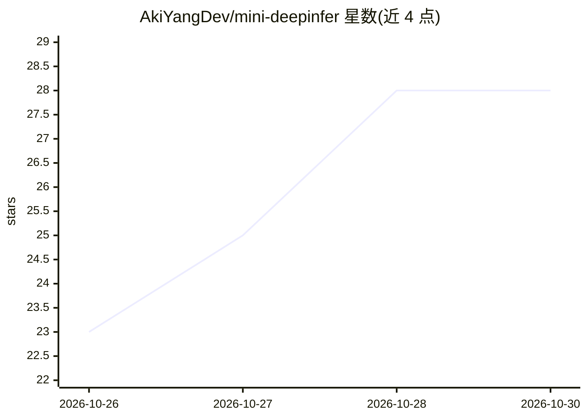

# AkiYangDev/mini-deepinfer

⭐ 28 · Python · Apache-2.0 · 推送 2026-10-25 · [GitHub](https://github.com/AkiYangDev/mini-deepinfer) · 个人维护 · 中文 README

**面向 Ascend 910C 的教学型 LLM 推理引擎，还原 DeepInfer 执行设计**

用精简 Python/PyTorch 实现的教学推理引擎，以 DeepInfer 执行设计为主线，覆盖请求调度、批处理、分块 prefill、KV/卷积/递推混合缓存、投机解码（0.8B 候选 + 2B 验证）、流式取消与概率采样。无 NPU 时可在 CPU 上运行数字运算演示与随机小模型；配备 910C 与 Qwen3.5 权重后可运行真实文本生成。提供十四课教程与 DeepInfer 源码映射，实机记录保留输入与源码 SHA 可复核。范围限于单设备 FP32 eager 短上下文，BF16/MLA/MoE/分布式尚未实现。

## 筛选速览

| 维度 | 判定 | 备注 |
|---|---|---|
| AI 角色 | `ai-ecosystem` | LLM/agent 周边工具 |
| 许可风险 | `permissive` | Apache-2.0 |
| 部署形态 | `None` |  |
| 模型依赖 | — | README 未给出锁定关系 |
| 硬件要求 | — | 无带数字的原话,不猜 |
| 安装摩擦 | `low` | 无编译、无系统依赖或容器化 |
| 成熟度 | — | 结构信号不足 |

## 能力要点

- 请求调度、分块 prefill、跨轮执行与缓存回收的精简实现
- 双模型投机解码：0.8B 候选、2B 验证，含拒绝后双缓存恢复
- CPU 数字运算演示零依赖可跑，无需 NPU 或权重
- Ascend 910C 实机验证记录（logits/概率对照、流式取消）保留源码 SHA 可复核

## 适用场景

- 想读推理引擎源码前，先在可运行的小型实现里跟读一条请求的全流程
- 在 Ascend 910C 上用真实 Qwen3.5 权重验证投机解码与批处理机制
- 无 NPU 时在 CPU 上观察调度、缓存槽位分配与候选拒绝恢复

## 场景标签

`推理引擎` `教程课程` · 领域:学习与行业

## 证据(README 行号)

> L15: mini-DeepInfer 是一个以 **DeepInfer 执行设计**为主线的教学推理引擎。它用精简的 Python 与 PyTorch 实现，把请求调度、模型执行、采样和结果提交串起来，让你能顺着一条请求读懂这些环节怎样配
> L21: Ascend 910C 是这个项目的实机平台，Qwen3.5 用来验证这些机制。没有 NPU，也能先跑 CPU 调度和随机小模型；准备好设备与权重后，再运行真实文本生成，让 0.8B 提候选、2B 做验证。
> L151: 执行设计主要参考 DeepInfer，mini-sglang提供精简实现与教学组织参考，Ascend SGLang 提供 NPU 接口参考。来源与许可证逐项记录。

## 星数曲线

2026-10-26 23 → 2026-10-30 28（+5）

---
*卡片 v1 · prompt 1.4 · 生成 2026-10-27 · 置信度 high · 依据 README sha `04c080580b3b` · [字段定义](../../DATASET.md)*
