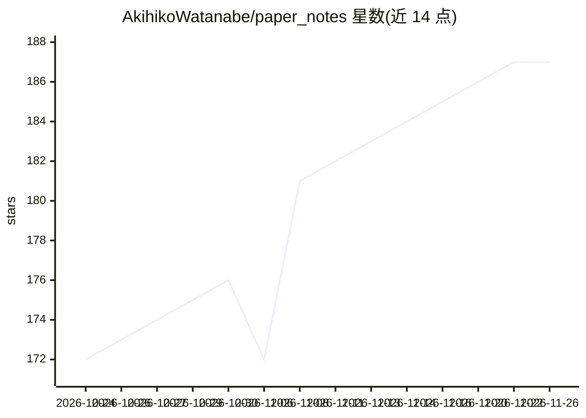

# AkihikoWatanabe/paper_notes

⭐ 187 · HTML · MIT · 推送 2026-11-25 · [GitHub](https://github.com/AkihikoWatanabe/paper_notes) · [官网](https://AkihikoWatanabe.github.io/paper_notes) · 个人维护

**AI 研究论文的人工策展笔记集（GitHub Issue 形式）**

维护者每日跟踪 X 上的 AI 研究讨论，将论文、博客等资源以 GitHub Issue 形式收录，内容含链接、arXiv API 获取的元数据与摘要、GPT 自动生成的日语摘要以及维护者的人工笔记，并按 600+ 标签分类。定位为个人学习日志与记忆辅助。每日将 Issue 导出为 agent_docs/ 下的 XML 文件，支持克隆仓库后用 AI agent 对话式查询，也可经 DeepWiki/CodeWiki 聊天界面浏览。笔记粒度不均，标注为人工手动进行。

## 筛选速览

| 维度 | 判定 | 备注 |
|---|---|---|
| AI 角色 | `ai-knowledge` | 知识聚合/清单类 |
| 许可风险 | `permissive` | MIT |
| 部署形态 | `None` |  |
| 模型依赖 | — | README 未给出锁定关系 |
| 硬件要求 | — | 无带数字的原话,不猜 |
| 安装摩擦 | `low` | 无编译、无系统依赖或容器化 |
| 成熟度 | — | 结构信号不足 |

## 能力要点

- 每条资源以 GitHub Issue 管理，含摘要、日语翻译与人工笔记
- 600+ 手动标签，支持按标签过滤和检索
- 每日导出 Issue 为 agent_docs/ XML，供 AI agent 检索问答
- 提供 DeepWiki/CodeWiki 聊天式浏览界面

## 适用场景

- 跟踪 LLM、AI agents、强化学习等方向的每日研究动态
- 克隆仓库后用 AI agent 对话式检索论文笔记
- 按标签查找某主题下的相关论文与讨论链接

## 场景标签

`精选清单` `科研工具` `知识库管理` · 领域:知识与检索

## 证据(README 行号)

> L19: This repository is a human-curated collection of AI research papers and related resources, including blog posts. Th
> L25: **All content stored in GitHub Issues is exported daily as XML files under `agent_docs/`.** An AI agent can use the

## 星数曲线

2026-10-24 172 → 2026-11-26 187（+15）

---
*卡片 v1 · prompt 1.4 · 生成 2026-11-26 · 置信度 high · 依据 README sha `02dcef575969` · [字段定义](../../DATASET.md)*
