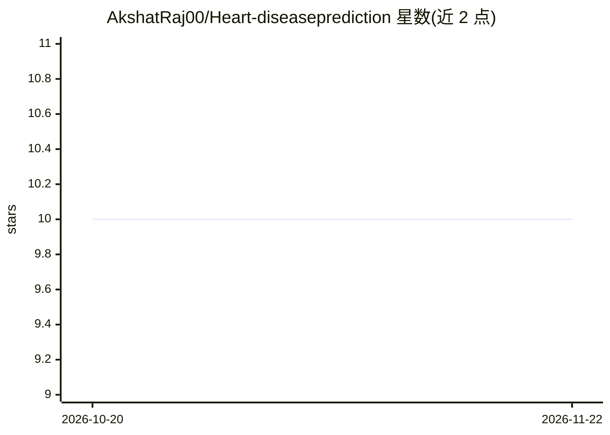

# AkshatRaj00/Heart-diseaseprediction

⭐ 10 · Python · MIT · 推送 2026-10-21 · [GitHub](https://github.com/AkshatRaj00/Heart-diseaseprediction) · [官网](https://heart-diseaseprediction-zhl7t64qx8w9h5zna3vrce.streamlit.app/) · 个人维护

**基于健康参数预测心脏病风险的机器学习 Web 应用**

一个根据用户健康参数估计心脏病风险的机器学习 Web 应用，结合预测建模与 Web 界面输出风险评估结果。模型推理核心基于 1,025 例造影确诊患者的多中心数据集（Cleveland、Hungarian、Zurich/Basel、Long Beach）。部署方式为 FastAPI/Uvicorn 后端加 Next.js 前端，本地运行后通过浏览器访问 API 文档与仪表盘。README 含许可声明（MIT）与引用信息。

## 筛选速览

| 维度 | 判定 | 备注 |
|---|---|---|
| AI 角色 | `ai-native` | 本体是模型或模型工具 |
| 许可风险 | `permissive` | MIT |
| 部署形态 | `None` |  |
| 模型依赖 | — | README 未给出锁定关系 |
| 硬件要求 | — | 无带数字的原话,不猜 |
| 安装摩擦 | `low` | 无编译、无系统依赖或容器化 |
| 成熟度 | — | 结构信号不足 |

## 能力要点

- 基于多中心数据集（n=1,025）训练的心脏病风险预测模型
- FastAPI 后端提供 API 文档接口（/docs）
- Next.js 前端仪表盘展示预测结果
- 输出 HL7/FHIR R4 格式 JSON 捆绑与 LOINC 编码字段

## 适用场景

- 根据健康参数估计个人心脏病风险
- 以 API 形式对外提供心脏病风险预测服务
- 查看风险预测结果的 Web 仪表盘

## 场景标签

 · 领域:医疗健康/疾病风险预测

## 证据(README 行号)

> L19: **CardioSense Autonomous Core** represents a generational leap over conventional ICU monitors and isolated machine 
> L21: CardioSense bridges predictive machine learning, high-acuity automated therapeutics, and real-time biometric teleme
> L128: py -m uvicorn backend.app.main:app --host 127.0.0.1 --port 8000 --reload

## 星数曲线

2026-10-20 10 → 2026-11-22 10（+0）

---
*卡片 v1 · prompt 1.4 · 生成 2026-11-20 · 置信度 mid · 依据 README sha `520dca8c4b32` · [字段定义](../../DATASET.md)*
