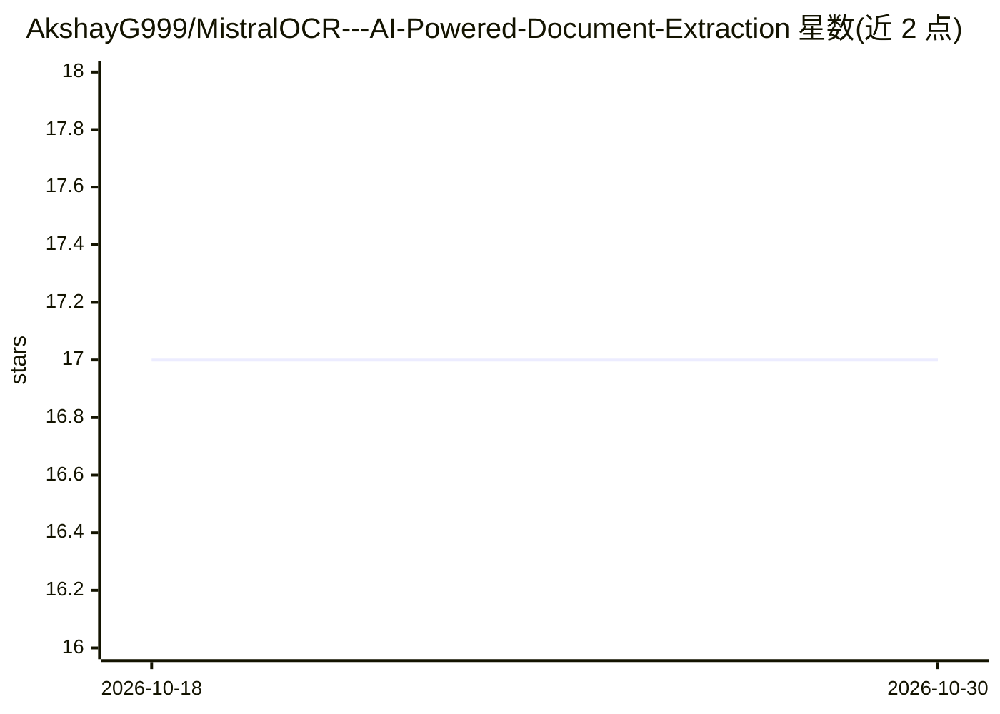

# AkshayG999/MistralOCR---AI-Powered-Document-Extraction

⭐ 17 · Python · MIT · 推送 2026-01-09 · [GitHub](https://github.com/AkshayG999/MistralOCR---AI-Powered-Document-Extraction) · 个人维护

**基于 Mistral AI OCR 的文档结构化提取应用（FastAPI+Streamlit）**

开源文档提取应用：通过 Mistral AI 的 OCR 与 LLM 能力，将 PDF 与 JPG/PNG 图片中的非结构化文本转换为结构化 JSON 数据。由 FastAPI 后端（端口 8000）与 Streamlit 界面（端口 8501）组成，上传文档后经 OCR 处理与 AI 结构化两步生成结果，可导出 JSON 或纯文本。运行需 Python 3.9+ 与用户自备的 Mistral API key；支持 Docker 构建部署与云端容器平台。适用发票、收据、证件、表单、合同等场景。

## 筛选速览

| 维度 | 判定 | 备注 |
|---|---|---|
| AI 角色 | `ai-native` | 本体是模型或模型工具 |
| 许可风险 | `permissive` | MIT |
| 部署形态 | `self-host` | docker 或自建部署 |
| 模型依赖 | — | README 未给出锁定关系 |
| 硬件要求 | — | 无带数字的原话,不猜 |
| 安装摩擦 | `low` | 无编译、无系统依赖或容器化 |
| 成熟度 | — | 结构信号不足 |

## 能力要点

- 调用 Mistral OCR+LLM 将 PDF/图片文本转为结构化 JSON
- FastAPI 后端提供 API（/docs 文档），Streamlit 提供上传界面
- 支持 PDF/JPG/PNG 统一处理流程，结果可导出 JSON 或纯文本
- Docker 部署，API key 通过环境变量或界面配置

## 适用场景

- 批量提取发票、收据的供应商、金额与日期字段
- 证件与纸质表单数字化为结构化数据
- 从合同、银行对账单等文档中提取关键字段

## 场景标签

`OCR` `文档解析` · 领域:知识与检索

## 证据(README 行号)

> L15: MistralOCR is an open-source application that extracts structured information from documents using Mistral's cuttin
> L64: 2. **OCR Processing** - The document is processed using Mistral's advanced OCR
> L65: 3. **AI Structuring** - OCR output is intelligently parsed into structured data

## 星数曲线

2026-10-18 17 → 2026-10-30 17（+0）

---
*卡片 v1 · prompt 1.4 · 生成 2026-10-30 · 置信度 high · 依据 README sha `365b4bcc7ebd` · [字段定义](../../DATASET.md)*
