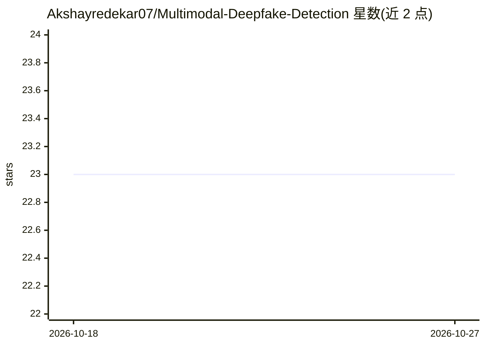

# Akshayredekar07/Multimodal-Deepfake-Detection

⭐ 23 · Jupyter Notebook · MIT · 推送 2026-08-14 · [GitHub](https://github.com/Akshayredekar07/Multimodal-Deepfake-Detection) · 个人维护

**检测图像与音频深伪的 Web 应用（EfficientNetV2+Wav2Vec2）**

基于 FastAPI 的 Web 应用，用微调的 EfficientNetV2 检测图像伪造痕迹、微调的 Wav2Vec2 检测合成语音，支持 JPG/PNG 与 MP3/WAV 上传，输出真/假分类与置信度，可批量处理并附带异常可视化；检测后立即删除用户上传的媒体。提供 git clone 源码安装（Python 3.10+、FFmpeg、模型文件需置于 models/）与 Docker 两种运行方式，另含训练 notebook 与测试样本。

## 筛选速览

| 维度 | 判定 | 备注 |
|---|---|---|
| AI 角色 | `ai-native` | 本体是模型或模型工具 |
| 许可风险 | `permissive` | MIT |
| 部署形态 | `self-host` | docker 或自建部署 |
| 模型依赖 | — | README 未给出锁定关系 |
| 硬件要求 | — | 无带数字的原话,不猜 |
| 安装摩擦 | `low` | 无编译、无系统依赖或容器化 |
| 成熟度 | — | 结构信号不足 |

## 能力要点

- EfficientNetV2 图像伪造检测 + Wav2Vec2 合成语音检测
- 拖拽上传、批量处理、输出分类与置信度
- 检测后立即删除上传媒体
- 提供 Docker 部署与训练 notebook

## 适用场景

- 上传图片或音频文件判断是否为深度伪造
- 批量筛查多个媒体文件的真伪
- 本地部署后在自己的环境中运行检测服务

## 场景标签

`目标检测` `多模态` · 领域:感知与多模态

## 证据(README 行号)

> L15:  - **EfficientNetV2** for image forgery detection
> L16:  - **Wav2Vec2** for detecting voice synthesis artifacts in audio
> L30: - **Image**: Fine-tuned **EfficientNetV2** trained to detect visual deepfake traces

## 星数曲线

2026-10-18 23 → 2026-10-27 23（+0）

---
*卡片 v1 · prompt 1.4 · 生成 2026-10-27 · 置信度 mid · 依据 README sha `2e8625b256da` · [字段定义](../../DATASET.md)*
