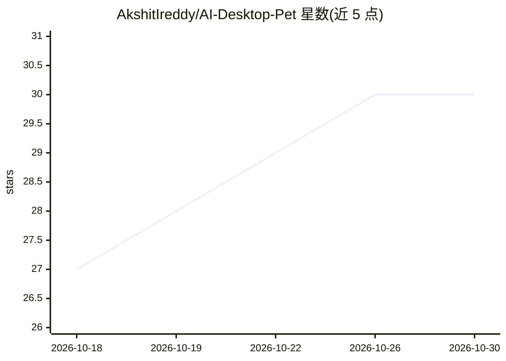

# AkshitIreddy/AI-Desktop-Pet

⭐ 30 · TypeScript · MIT · 推送 2026-09-30 · [GitHub](https://github.com/AkshitIreddy/AI-Desktop-Pet) · [官网](https://www.linkedin.com/company/alystria-ai/) · 个人维护

**带 AI 对话能力的桌面宠物：行走桌面、看屏幕、记事、语音聊天**

基于 Tauri/Rust 的跨平台桌面宠物应用：动画角色在任务bar行走、攀爬窗口、追逐光标，支持多宠物互动等 20 种环境行为。AI 部分通过 Convai Web SDK 提供 WebRTC 实时语音对话、流式文字聊天、限时授权的屏幕视觉与可选长期记忆（默认关闭，需 Convai 付费档位支持）。每角色可从 22 项技能目录中配置 8 项技能，含提醒、专注计时等。需注册 Convai 并填入 API key；提供 Windows/macOS/Linux 安装包，也可从源码构建。

## 筛选速览

| 维度 | 判定 | 备注 |
|---|---|---|
| AI 角色 | `ai-enhanced` | 去掉 AI 部分产品仍成立 |
| 许可风险 | `permissive` | MIT |
| 部署形态 | `desktop` | 安装包/桌面程序 |
| 模型依赖 | — | README 未给出锁定关系 |
| 硬件要求 | — | 无带数字的原话,不猜 |
| 安装摩擦 | `low` | 无编译、无系统依赖或容器化 |
| 成熟度 | — | 结构信号不足 |

## 能力要点

- Convai Web SDK 实时语音对话与流式文字聊天
- 限时授权的屏幕视觉（倒计时徽章、自动收回、不留存画面）
- 默认关闭的长期记忆与应用内记忆日志（可浏览/删除）
- 每角色 8 技能（目录 22 项）与 20 种环境行为

## 适用场景

- 让桌面宠物陪伴工作，语音或文字对话
- 设置语音提醒与便利贴
- 给宠物限时查看屏幕以获得上下文感知对话

## 场景标签

`AI 助手` `语音 Agent` · 领域:对话与助手

## 证据(README 行号)

> L5: Tiny animated characters that walk your taskbar, climb your windows, chase your cursor, befriend each other, remembe
> L18: - 🗣️ **Convai Web SDK 1.6 (beta)** — realtime WebRTC voice conversations, streaming text chat, and dynamic context 
> L22: - 🐾 **20 ambient behaviors** — including **walking on your app windows**, sitting on window sills, peeking from beh

## 星数曲线

2026-10-18 27 → 2026-10-30 30（+3）

---
*卡片 v1 · prompt 1.4 · 生成 2026-10-26 · 置信度 high · 依据 README sha `0a17f577d1a5` · [字段定义](../../DATASET.md)*
