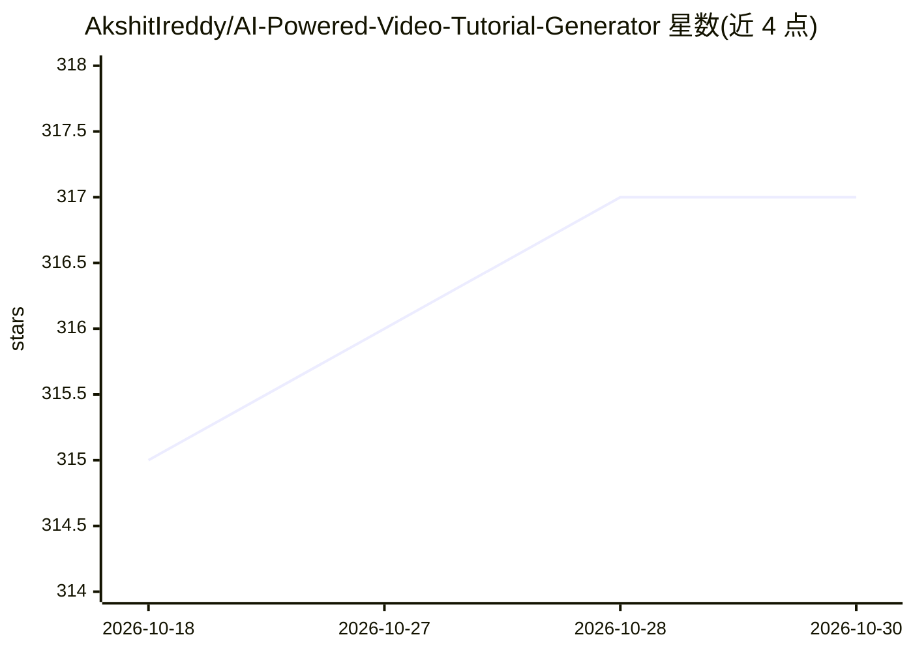

# AkshitIreddy/AI-Powered-Video-Tutorial-Generator

⭐ 317 · Python · MIT · 推送 2026-09-21 · [GitHub](https://github.com/AkshitIreddy/AI-Powered-Video-Tutorial-Generator) · [官网](https://www.linkedin.com/company/alystria-ai) · 个人维护

**Windows 桌面 AI 视频教程生成器：从主题到可编辑成片**

面向用户的 Windows 桌面应用：输入主题、问题或源材料，经研究、脚本、分镜、配音、插画、讲解人动画到时间线编辑与导出，全流程在一个工作区内完成。支持无讲解人或最多四人讲解人阵容（写实/动漫/卡通/动物风格），提供本地模型（ComfyUI/SDXL 插画、SoulX 动画）与自带密钥的云端文本/研究（Groq、Gemini、Mistral、OpenRouter、NVIDIA NIM）两种路径。项目保存为本地文件夹，含来源与权利记录。技术栈为 Tauri + React + Rust + Python pipeline。

## 筛选速览

| 维度 | 判定 | 备注 |
|---|---|---|
| AI 角色 | `ai-native` | 本体是模型或模型工具 |
| 许可风险 | `permissive` | MIT |
| 部署形态 | `None` |  |
| 模型依赖 | locked-api |  |
| 硬件要求 | — | 无带数字的原话,不猜 |
| 安装摩擦 | `low` | 无编译、无系统依赖或容器化 |
| 成熟度 | — | 结构信号不足 |

## 能力要点

- 从主题/源材料到导出的完整教程生成流水线，各阶段有人工审阅点
- 最多四人讲解人阵容，八幅肖像通过 SoulX-FlashHead Pro 动画评审
- 本地（ComfyUI/SDXL、SoulX）与自带密钥云端（Groq/Gemini/Mistral/OpenRouter/NVIDIA NIM）双路径，无静默回退
- 原生时间线编辑器，导出视频、字幕、文稿、书目与 .alytutorial 项目归档

## 适用场景

- 把一个问题或主题做成带讲解人的教学视频
- 在本地模型上私有化生成插画与讲解人动画
- 带审阅点地控制脚本、分镜与来源引用后再生成的教育内容制作

## 场景标签

`视频生成` `图像生成` `语音合成` · 领域:内容生成

## 证据(README 行号)

> L13:  Research, script, storyboard, narrate, animate presenters, refine the timeline,
> L107: |Cloud text and research|Writing and research with Groq, Gemini, Mistral, OpenRouter, NVIDIA NIM, or another revie
> L121: Run the installer and open **AI Video Tutorial Generator** from the Start menu. The core Python,

## 星数曲线

2026-10-18 315 → 2026-10-30 317（+2）

---
*卡片 v1 · prompt 1.4 · 生成 2026-10-21 · 置信度 high · 依据 README sha `164d6d6c8ee2` · [字段定义](../../DATASET.md)*
