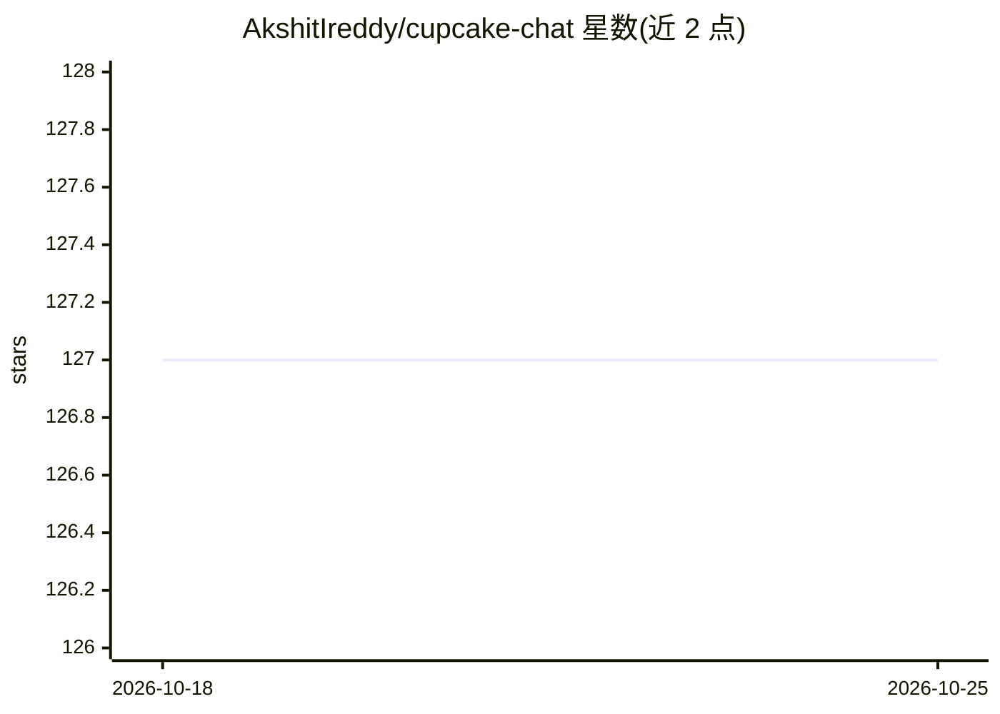

# AkshitIreddy/cupcake-chat

⭐ 127 · Python · MIT · 推送 2026-09-21 · [GitHub](https://github.com/AkshitIreddy/cupcake-chat) · 个人维护

**面向普通用户的 Windows AI 聊天客户端：多模型对话与可复用顾问团队**

Windows 桌面聊天应用（Tauri 2 + React + Rust），让用户连接 Groq、Gemini、Mistral、Cohere、OpenAI、Anthropic、xAI、OpenRouter、Cloudflare Workers AI、NVIDIA NIM 等托管服务商，或通过 Cupcake Local 在本机以 CPU/CUDA/Vulkan 运行 GGUF 模型。特色是可命名的“Cupcake 顾问”（内置 15 个日常顾问与 24 个历史人物），支持 @提及与智能群聊；项目内聚合聊天、文件、任务、工件与记忆，可在对话中运行并测试 Python 代码。仅提供 Windows x64 安装包（NSIS + WebView2），密钥用 DPAPI 存储。

## 筛选速览

| 维度 | 判定 | 备注 |
|---|---|---|
| AI 角色 | `ai-native` | 本体是模型或模型工具 |
| 许可风险 | `permissive` | MIT |
| 部署形态 | `desktop` | 安装包/桌面程序 |
| 模型依赖 | local-ok | 支持本地模型 |
| 硬件要求 | — | 无带数字的原话,不猜 |
| 安装摩擦 | `medium` | 含编译或系统依赖之一 |
| 成熟度 | — | 结构信号不足 |

## 能力要点

- 接入 10+ 托管模型服务商，路由显式、切换不静默重发
- Cupcake Local 本地运行 GGUF 模型（CPU/CUDA/Vulkan），自动推荐兼容模型
- 可复用顾问：15 个日常顾问 + 24 个历史人物，支持 @提及与智能群聊
- 对话内直接运行 Python 测试，结果存为工件与任务（Windows 沙箱）

## 适用场景

- 在多个模型服务商之间切换做日常问答与比较选择
- 组建带角色设定的顾问团队，分组讨论旅行、账单、学习等问题
- 离线在本机运行模型，让对话数据留在电脑上
- 把回答中的代码在聊天里直接运行测试并保存为工件

## 场景标签

`聊天机器人` `AI 助手` · 领域:对话与助手

## 证据(README 行号)

> L37: - **One chat, many model choices.** Connect Groq, Gemini, Mistral, Cohere, NVIDIA NIM, OpenRouter,
> L40: - **Optional local AI.** Cupcake Local detects the computer, recommends compatible models, manages
> L138: Cupcake Chat is a Windows-first Tauri 2 application with small, typed boundaries between the UI and

## 星数曲线

2026-10-18 127 → 2026-10-25 127（+0）

---
*卡片 v1 · prompt 1.4 · 生成 2026-10-23 · 置信度 mid · 依据 README sha `0a3e385dab9b` · [字段定义](../../DATASET.md)*
