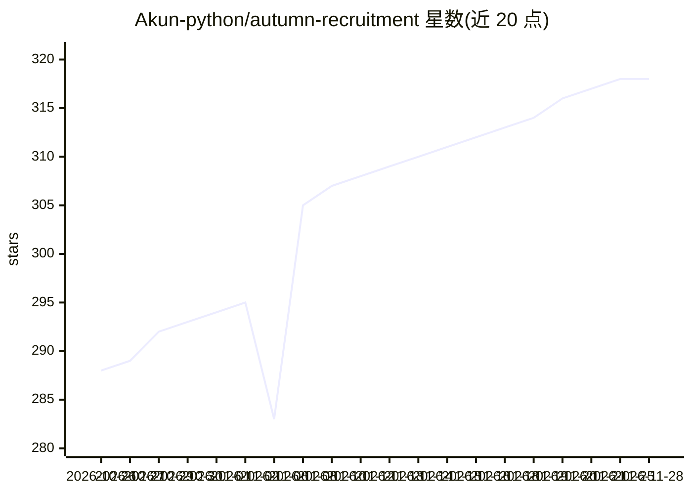

# Akun-python/autumn-recruitment

⭐ 318 · Jupyter Notebook · MIT · 推送 2026-11-23 · [GitHub](https://github.com/Akun-python/autumn-recruitment) · 个人维护 · 中文 README

**面向秋招求职者的算法与大模型学习笔记仓库**

个人发起的社区共建学习资料仓库，含 26 个主题模块、279 篇教学 Notebook，覆盖数学、数据结构、机器学习、深度学习、LLM、智能体、AI-Infra、语音、数据科学等方向。以「理解→推导→手写→运行→验证→复盘」组织内容，Notebook 从零实现并配合断言、固定随机种子与验证脚本保证可复现，每模块含高频面试题与自测。MIT 许可，中文教学，需 Python 3.9+，多数示例可离线运行。

## 筛选速览

| 维度 | 判定 | 备注 |
|---|---|---|
| AI 角色 | `ai-knowledge` | 知识聚合/清单类 |
| 许可风险 | `permissive` | MIT |
| 部署形态 | `None` |  |
| 模型依赖 | — | README 未给出锁定关系 |
| 硬件要求 | — | 无带数字的原话,不猜 |
| 安装摩擦 | `low` | 无编译、无系统依赖或容器化 |
| 成熟度 | — | 结构信号不足 |

## 能力要点

- 26 个主题模块、279 篇教学 Notebook
- 核心算法从零手写实现，配合数值断言与验证脚本
- 每模块包含高频面试题、手撕清单与自测题
- 提供四条学习路线（算法基础/大模型应用/AI 工程/具身智能）

## 适用场景

- 准备算法与大模型方向的秋招面试
- 从零手写实现 Transformer、KV Cache、FlashAttention 等加深理解
- 按路线系统学习 AI-Infra 与推理优化知识
- 复现并验证教学 Notebook 中的实验

## 场景标签

`教程课程` · 领域:学习与行业

## 证据(README 行号)

> L5:  面向大模型时代的算法、工程与 AI 学习共建仓库
> L118: 当前仓库包含 **26 个主题模块、279 篇教学 Notebook**，并持续增加中。

## 星数曲线

2026-10-26 288 → 2026-11-28 318（+30）

---
*卡片 v1 · prompt 1.4 · 生成 2026-11-25 · 置信度 high · 依据 README sha `eac66266711b` · [字段定义](../../DATASET.md)*
