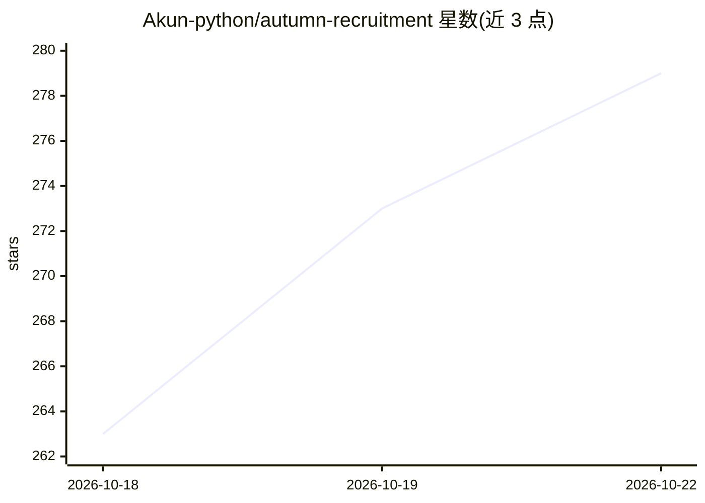

# Akun-python/autumn-recruitment

⭐ 282 · Jupyter Notebook · MIT · 推送 2026-10-15 · [GitHub](https://github.com/Akun-python/autumn-recruitment) · 个人维护 · 中文 README

**面向秋招的算法/AI 中文学习共建仓库（26 模块 273 Notebook）**

个人发起、社区共建的中文教学仓库，覆盖数学基础、数据结构与算法、机器学习、深度学习、LLM、Agent、AI-Infra、语音、具身智能、数据科学等 26 个主题模块、273 篇 Notebook。方法论为「理解→推导→手写→运行→验证→复盘」，排序、LR、SVM、Transformer、PPO 等尽量从零实现，代码自包含、固定随机种子、带断言对照，大部分示例离线可运行、不需要 GPU。提供 4 条学习路线与本地批量验证脚本，面向秋招面试准备与系统学习 AI 的学生与开发者。

## 筛选速览

| 维度 | 判定 | 备注 |
|---|---|---|
| AI 角色 | `ai-knowledge` | 知识聚合/清单类 |
| 许可风险 | `permissive` | MIT |
| 部署形态 | `None` |  |
| 模型依赖 | — | README 未给出锁定关系 |
| 硬件要求 | — | 无带数字的原话,不猜 |
| 安装摩擦 | `low` | 无编译、无系统依赖或容器化 |
| 成熟度 | — | 结构信号不足 |

## 能力要点

- 26 个主题模块、273 篇可运行教学 Notebook
- 排序/DP/LR/SVM/CNN/PPO/Transformer 等从零实现
- Notebook 自包含、固定随机种子、断言数值对照，附验证脚本
- 4 条推荐学习路线（基础/大模型/AI 工程/具身智能）

## 适用场景

- 秋招面试系统性准备算法、机器学习与 LLM 知识
- 按模块手写实现并验证经典算法与模型
- 查找各方向的高频面试题与手撕清单

## 场景标签

`教程课程` · 领域:学习与行业

## 证据(README 行号)

> L5:  面向大模型时代的算法、工程与 AI 学习共建仓库
> L118: 当前仓库包含 **26 个主题模块、273 篇教学 Notebook**，并持续增加中。

## 星数曲线

2026-10-18 263 → 2026-10-22 279（+16）

---
*卡片 v1 · prompt 1.4 · 生成 2026-10-22 · 置信度 high · 依据 README sha `87fcce2f6071` · [字段定义](../../DATASET.md)*
