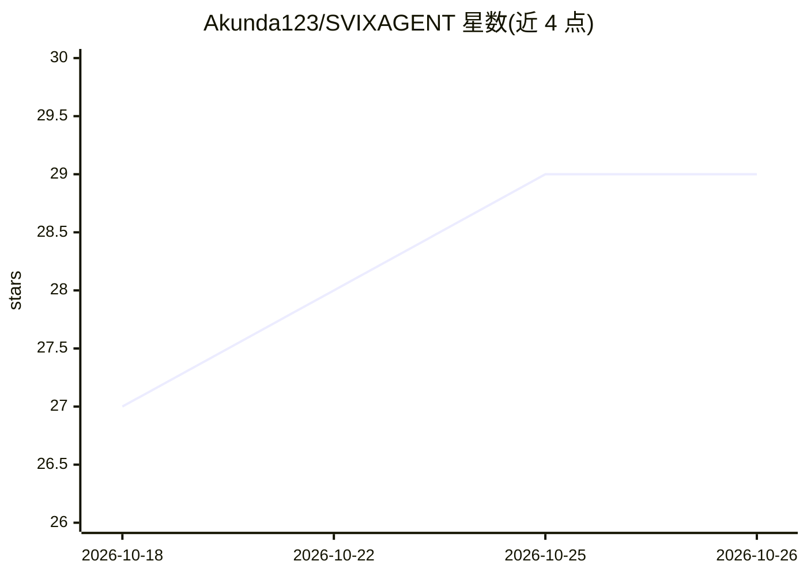

# Akunda123/SVIXAGENT

⭐ 29 · JavaScript · MIT · 推送 2026-10-09 · [GitHub](https://github.com/Akunda123/SVIXAGENT) · 个人维护 · 中文 README

**用对话操作 Synthesizer V Studio/Instrument X 的 AI 音乐制作助手**

AKDAgent 是基于 DSH（DeepSeek Harness）的桌面客户端，面向 Synthesizer V Studio（SV1/SV2）、Instrument X 及 ACE Studio 用户：通过悬浮球或宿主侧栏面板对话，经跑在宿主内的 Lua 桥读写工程，提供 53 个 MCP 工具，覆盖音频分析与对轨、音符/音高线/参数编辑、旋律和声生成、歌词对位、音素咬字、伴奏织体、声库编辑与五线谱识别（内置本地 OMR）。支持 12 个内置模型提供方与订阅登录，语音输入为本地模型按需下载。限制：macOS 仅 Apple Silicon，桥每次进宿主需手动运行，同时间仅 1 个 SV + 1 个 IX。

## 筛选速览

| 维度 | 判定 | 备注 |
|---|---|---|
| AI 角色 | `ai-native` | 本体是模型或模型工具 |
| 许可风险 | `permissive` | MIT |
| 部署形态 | `desktop` | 安装包/桌面程序 |
| 模型依赖 | locked-api |  |
| 硬件要求 | — | 无带数字的原话,不猜 |
| 安装摩擦 | `low` | 无编译、无系统依赖或容器化 |
| 成熟度 | — | 结构信号不足 |

## 能力要点

- 53 个 MCP 工具 + Lua 桥 32 个 op，经本机文件交换读写工程
- 44 项功能分 11 类：音频分析/音符编辑/旋律和声/歌词/音素/音高/参数/IX 织体/声库/OMR 识谱
- 12 个内置模型提供方 + 6 家订阅登录；凭据仅存本机
- 语音输入本地识别不上传；识谱引擎（悦谱 Dolce）全本地离线

## 适用场景

- 在 SV/IX 里用自然语言批量改音符、音高线与参数
- 从伴奏音频分析和弦并自动铺伴奏织体
- 把五线谱图片或 MusicXML 导入工程、歌词对位填词
- 用语音输入代替打字与助手对话

## 场景标签

`AI 助手` · 领域:对话与助手

## 证据(README 行号)

> L3: > **以 DSH（DeepSeek Harness）为底层、用对话操作 Synthesizer V Studio / Instrument X 的智能助手。**
> L20: **AKDAgent 是一个以 DSH 为底层、用对话操作 Synthesizer V Studio / Instrument X 的智能助手。**
> L178: - **分析音频**：速度 / 节拍 · 调性 · **和弦** · **情绪**（喜 / 宁静 / 愤 / 悲伤 四类）· 音高中位数（可只分析某一段）—— **很快**：3 分钟的伴奏**十秒上下**出结果

## 星数曲线

2026-10-18 27 → 2026-10-26 29（+2）

---
*卡片 v1 · prompt 1.4 · 生成 2026-10-26 · 置信度 high · 依据 README sha `9af8bf426834` · [字段定义](../../DATASET.md)*
