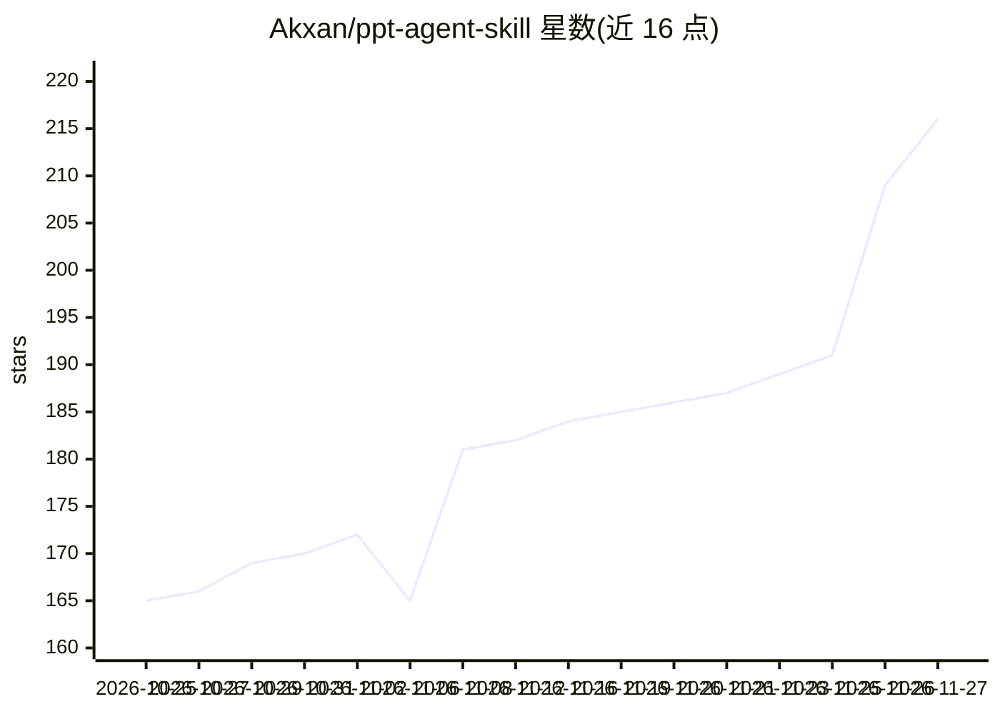

# Akxan/ppt-agent-skill

⭐ 216 · HTML · MIT · 推送 2026-11-18 · [GitHub](https://github.com/Akxan/ppt-agent-skill) · [官网](https://akxan.github.io/ppt-agent-skill/) · 个人维护 · 中文 README

**把一句话变成设计级 PPT 的 Claude Code Skill**

以 Claude Code Skill 形式分发的演示文稿生成系统：用户输入一句话需求后，按 6 步 Pipeline（需求调研→资料搜集→大纲策划→策划稿→HTML 设计稿→后处理）产出翻页 HTML、SVG 与可编辑 PPTX。内置 26 种风格定义、18 种纯 HTML/CSS/SVG 图表、Bento Grid 布局规则、排版规则与 8 种失败模式目录，各步以 JSON 合同传递。导出 SVG/PPTX 需 Python≥3.9 与 Node.js≥18；缺依赖时仍交付 HTML 预览。提供 smoke 测试与严格模式校验脚本。

## 筛选速览

| 维度 | 判定 | 备注 |
|---|---|---|
| AI 角色 | `ai-native` | 本体是模型或模型工具 |
| 许可风险 | `permissive` | MIT |
| 部署形态 | `library` | 以包/库形式分发 |
| 模型依赖 | locked-api |  |
| 硬件要求 | — | 无带数字的原话,不猜 |
| 安装摩擦 | `low` | 无编译、无系统依赖或容器化 |
| 成熟度 | — | 结构信号不足 |

## 能力要点

- 6 步 Pipeline 生成 HTML/SVG/可编辑 PPTX，PPTX 中文字为文本框、图形为原生形状
- 26 种风格定义（5 板块）与 18 种数据可视化模板，图表无 JS 运行时
- Reference Library 机制：风格/图表/排版/失败模式/布局 5 类规则文件注入各步骤
- 提供 smoke_test.py 测试套件与 validate.py 逐步校验

## 适用场景

- 一句话生成汇报、培训、路演用的演示文稿
- 把已有文档或报告转换成 slides
- 按指定风格（暗黑科技风等）定制 PPT 视觉

## 场景标签

 · 领域:办公/内容生成工具

## 证据(README 行号)

> L41: 一个 **Claude Code Skill**，模拟万元/页 PPT 设计公司的完整工作流，把一句话变成专业级演示文稿（HTML 预览 + 带切换动画的可编辑 PPTX）。
> L51: |**6 步 Pipeline**|需求调研 → 资料搜集 → 大纲策划 → 策划稿 → HTML 设计稿 → 后处理（SVG + PPTX）|

## 星数曲线

2026-10-25 165 → 2026-11-27 216（+51）

---
*卡片 v1 · prompt 1.4 · 生成 2026-11-26 · 置信度 mid · 依据 README sha `97241c86c7c1` · [字段定义](../../DATASET.md)*
