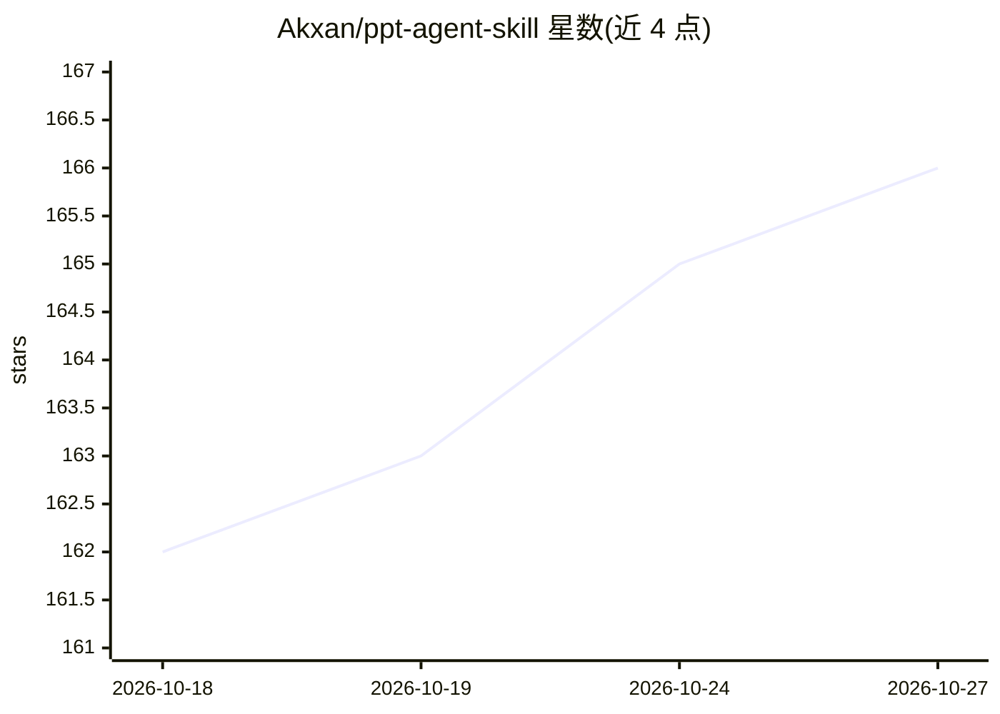

# Akxan/ppt-agent-skill

⭐ 166 · Python · MIT · 推送 2026-05-11 · [GitHub](https://github.com/Akxan/ppt-agent-skill) · [官网](https://github.com/Akxan/ppt-agent-skill) · 个人维护 · 中文 README

**Claude Code 技能：把一句话生成专业级演示文稿（HTML+可编辑 PPTX）**

一个运行于 Claude Code 的 Skill（以 SKILL.md 指令与 references 规则库形式提供），通过 6 步管线（需求调研→资料搜集→大纲→策划稿→HTML 设计稿→SVG/PPTX 后处理）把一句话 prompt 转换为演示文稿，输出翻页 HTML、矢量 SVG 与可在 PPT 365 中转换为形状的可编辑 PPTX。内置 26 种风格（5 板块）、18 种纯 HTML/CSS/SVG 图表、Bento Grid 布局与排版规则库，图表无 JS 运行时。依赖 python-pptx/lxml/Pillow 与 Node.js≥18（puppeteer 首次运行时自动安装），限制为需在 Claude Code 内调用。

## 筛选速览

| 维度 | 判定 | 备注 |
|---|---|---|
| AI 角色 | `ai-ecosystem` | LLM/agent 周边工具 |
| 许可风险 | `permissive` | MIT |
| 部署形态 | `library` | 以包/库形式分发 |
| 模型依赖 | — | README 未给出锁定关系 |
| 硬件要求 | — | 无带数字的原话,不猜 |
| 安装摩擦 | `low` | 无编译、无系统依赖或容器化 |
| 成熟度 | — | 结构信号不足 |

## 能力要点

- 6 步 Pipeline：从一句话到 HTML 设计稿再转可编辑矢量 PPTX
- 26 种风格 / 5 板块 / 18 种无 JS 运行时的数据可视化图表
- Reference Library 注入机制：风格/图表/排版铁律/失败模式/Bento 布局
- 提供 smoke_test.py 质量自检与 gallery.py 风格画廊生成

## 适用场景

- 在 Claude Code 里用一句话生成商业汇报或路演 deck
- 把已有文档/报告转成带真实数据图表的演示文稿
- 按品牌风格（暗色 SaaS、杂志感、国潮等）挑选版式生成 PPT

## 场景标签

 · 领域:办公文档生成/AI Agent 技能

## 证据(README 行号)

> L40: 一个 **Claude Code Skill**，模拟万元/页 PPT 设计公司的完整工作流，把一句话变成专业级演示文稿（HTML + 可编辑矢量 PPTX）。
> L188: - **TIER 1 · 入口** — 用户一句话 prompt 触发 SKILL.md（Agent 入口主流程指令）；引用 `references/` 下的所有规则文件
> L190: - **TIER 3 · 输出** — 4 种最终产物：翻页 HTML / 矢量 SVG / 可编辑 PPTX / 风格预览画廊

## 星数曲线

2026-10-18 162 → 2026-10-27 166（+4）

---
*卡片 v1 · prompt 1.4 · 生成 2026-10-22 · 置信度 low · 依据 README sha `69f5a9011725` · [字段定义](../../DATASET.md)*
